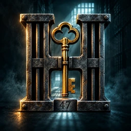
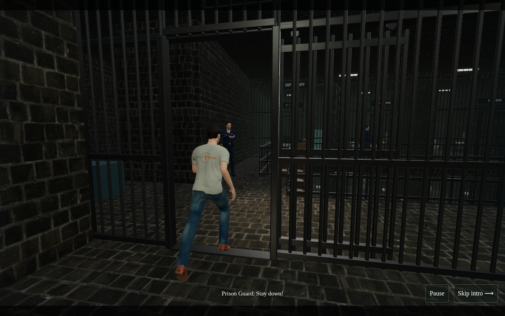
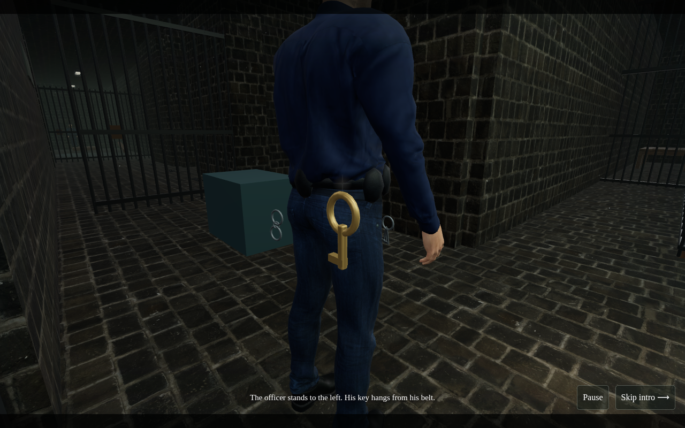
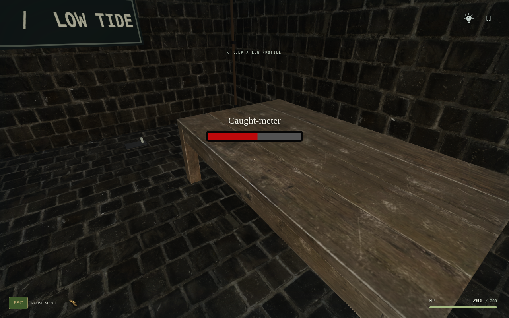
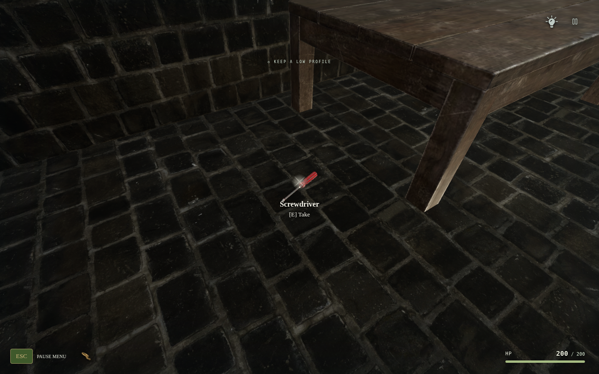
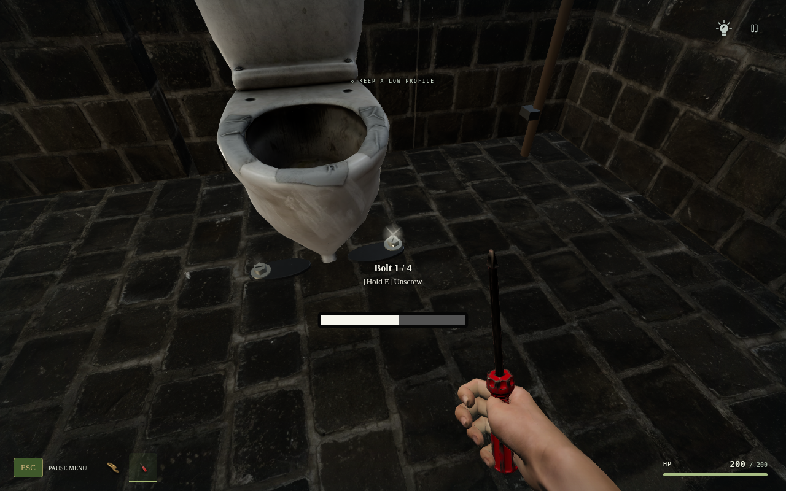
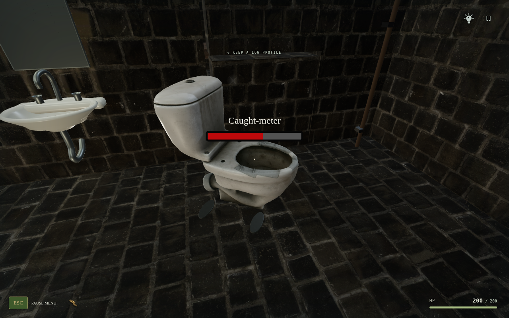

<div align="center">



# H I R O D O R A

### THE OBSIDIAN PENITENTIARY

**Every sound has a consequence.**

**v0.24.0 · Clean Push Meter · Four Bolts · Belt Key · Distance-Synced Steps**

**[↓ DOWNLOAD ANDROID APK](https://raw.githubusercontent.com/Rememberfrxst/Hirodora/main/downloads/Hirodora-0.24.0-android.apk)**

[↓ Offline web ZIP](https://raw.githubusercontent.com/Rememberfrxst/Hirodora/main/downloads/Hirodora-0.24.0-offline.zip) · [Single-file HTML download](https://raw.githubusercontent.com/Rememberfrxst/Hirodora/main/downloads/Hirodora-0.24.0.html) · [ZIP checksum](downloads/latest.json) · [APK checksums](downloads/android-latest.json) · [Android installation](docs/ANDROID.md)

</div>

## A playable prison atrium

**v0.24.0 cleans up the opening puzzle.** Table/toilet pushing shows **only the red Caught-meter**, without Move/Hold text, a white work bar or Push hard button. Hold E / the touch hand to push slowly; prolonged pushing accelerates risk, so stop to cool down. Each of the **four real toilet bolts** is a separate aim/hold target with its own white progress, **Bolt / Hold Unscrew**, and no red meter. Partial work and arbitrary removal order survive saves.

The table footprint is larger, the supplied toilet is uniformly enlarged without changing its proportions, and the screwdriver now lies above the floor rather than underneath it. Nearby available items have a subtle depth-tested glint and material sheen. The opening officer starts farther away on screen-left, then keeps a left-hand post: the key hangs on his actual belt. Taking it plays the newly supplied Max recording, **“Where is key?”**, with matching dialogue text. Officers are now 2.04m (captains 2.08m). Walking/running poses and footstep contacts share distance-based phase, including the escaping cellmate; melee has a revised wind-up/recovery. These remain authored animations, not new motion capture. [Changes and verification](docs/UPDATE-V24.md).

**v0.23.0 adds a playable Cell 015 → security wing → underground tunnel → island defence compound → escape boat route.** Take the pistol from Cell 46, use the existing stairs to the lower floor and open Cell 015. Its rear service door leads to three locked security rooms with six armed officers. Clear each pair to release the next bulkhead; the command hatch leads down to a real service tunnel. Climb out into a 110 × 70m compound with ten armed sentries, barracks, towers and cargo cover. Secure the compound, release the eastern dock gate and board the boat.

Enemy bullets deal **50 HP**: four confirmed hits defeat the 200-HP player. Aim is telegraphed and solid cover/lost visibility cancels firing. Death returns to the last safe checkpoint after two seconds; safe milestones refill health and the six-round magazine. New combat areas do not overwrite checkpoints on every shot or pause. Player damage remains two body hits / one headshot. All officers are taller (1.95m; captains 1.99m). The first-person pistol now follows a bounded finger pose instead of pulling the index into a fixed IK target. [Route, controls and verification](docs/UPDATE-V23.md).

**v0.22.0 adds reference-style object work and a voiced wake-up intro.** Holding E / Interact on the table, toilet bolts or toilet raises a red **Caught-meter**. Release to cool it; the white action-progress bar keeps completed work. Letting red reach full produces a real spatial clatter and sends a nearby hearing guard to investigate, rather than instantly ending the game. Work in short bursts and keep aiming at the moving object.

Select **New game** to see the new 24.6-second intro: the cellmate wakes you, notices the open door, tries to escape and is shot. All five supplied ElevenLabs recordings are matched to their scene events and subtitles, including “Hey, bro, wake up!”, “Stay down!” and “Oh, he's dead!”. Continue preserves an existing save without replay. [Implementation, voice provenance and verification](docs/UPDATE-V22.md).

**v0.21.0 adds a black loading screen with real asset-preparation progress**, waiting for models, textures, recordings and shaders. Mobile uses a shared 1K version of the same PBR materials; desktop retains 2K. The ammo card has the settings panel's colour at 50% background alpha and can be dragged/resized in Custom HUD. HP remains at the bottom; backpack/noise/awareness/standing blocks are removed. A new original architectural H logo is included in Android and iPhone/Home Screen icons.

The new finger pose seats the pistol into the hand and aligns the trigger/thumb contact. Shots produce flash, smoke and damped recoil; breathing/walking/reload animation keeps the arm and weapon together. The supplied toilet is slightly larger, with matching collision bounds, washers, hex anchors and rounded mounting lugs. [Implementation and verification](docs/UPDATE-V21.md).

The two stair tops remain in front of Cell 048 and Cell 036. The uploaded wooden stair models, real floor openings, safety rails, physical movement and guard navigation are fitted together. The lower floor has **3.5m clear height** beneath the upper slab. Every lower cell has a readable number on a masonry band above its gate.

**Your uploaded “Hands model rigged” is now the first-person mesh**, retaining its real skin textures, normal/roughness maps and finger joints. Only the right hand is visible during ordinary tool/gun use. The left support hand enters during the authored reload animation, then disappears. The screwdriver, keys and 10mm use separate anatomical grips. This replaces the previous MakeHuman-derived black-glove player arm; guards keep their existing licensed models.

The pistol has a **six-shot magazine with unlimited reserve**. Press **R** or tap **Reload** to refill it in 1.8 seconds. Reload pauses with gameplay and cancels when changing equipment; firing is blocked during reload. The top-left weapon card shows the actual pistol silhouette, remaining rounds, six magazine segments and ∞ reserve. Old ACT/objective text is removed from that corner; HP remains available at the bottom.

Aim at a pickup to see its name and **[E] Take** near the reticle (**[Tap] Take** on touch devices). Guard dialogue appears as readable speaker/text at the bottom centre, without a grey panel. Hint and Pause remain at top right; collected item icons remain at bottom left.

**Cell 46's table holds the supplied textured 10mm pistol and soda can.** Aim and press E / Interact to take the pistol, then aim at the can with it equipped to attach the fictional muzzle effect. Damage is unchanged: **100 per body hit, two body hits to defeat a 200 HP officer, or one headshot**. Walls and closed grilles stop bullets. Corpses remain at their fall positions and persist through checkpoints; New game resets them. The legacy dart pistol remains non-lethal.

Block C still has **48 cells: 12 left and 12 right on each floor**. Its 12m-wide corridor surrounds a 6m central opening; original cell widths, depths and individual 1.4m sliding wickets remain. The **uploaded metal bridge still connects Cell 041 ↔ 054** upstairs. Lower-floor cargo, four upper officers, five lower officers, cinematic intro, stealth AI and Cell 47's puzzle are preserved. Cell 46's opening-chapter gate remains open for exploration.

Player health is **200 HP**; guard melee has a visible wind-up and **25-damage** contact moment, with spacing and a shared grace window. Jab/cross/hook and reload presentation are authored skeletal animation, not new motion capture, ragdoll physics or a complete tactical-reload simulation.

**Safari compatibility:** all 70 licensed recordings now have MP3 runtime derivatives, fixing the Ogg Vorbis compatibility gap in older iOS Safari. Touch/landscape handling also recognises desktop-mode iPads, and interrupted Safari audio can resume after a user gesture. See the [iPhone/iPad guide](docs/IOS.md) for installation and the remaining verification limits.

[Current implementation / verification](docs/UPDATE-V24.md) · [Island route](docs/UPDATE-V23.md) · [Voiced intro](docs/UPDATE-V22.md) · [Loading/HUD update](docs/UPDATE-V21.md) · [Previous stairs/hands update](docs/UPDATE-V20.md) · [Character credits](docs/GUARD-ASSETS.md)

## Latest screenshots — exactly six

Six actual game renders with fixed intro seeks and inspection cameras. [Capture cameras and puzzle states](docs/screenshots/update-v24/capture.json). These are not recorded playthroughs or physical-phone benchmarks; separate browser tests verify the interactions. Historical galleries remain separate.

<table>
<tr><td width="50%"></td><td width="50%"></td></tr>
<tr><td align="center"><sub>INTRO · LEFT SENTRY</sub></td><td align="center"><sub>BELT KEY</sub></td></tr>
<tr><td></td><td></td></tr>
<tr><td align="center"><sub>TABLE · CAUGHT METER ONLY</sub></td><td align="center"><sub>SCREWDRIVER · REVEAL</sub></td></tr>
<tr><td></td><td></td></tr>
<tr><td align="center"><sub>BOLT · HOLD UNSCREW</sub></td><td align="center"><sub>TOILET · CAUGHT METER ONLY</sub></td></tr>
</table>

## Play on mobile

**Android:** download the APK above, open it in Files and allow installation from that source. Requires Android 8.0+, an updated Android System WebView and WebGL 2. All models, textures and audio are included, with no Internet, storage, microphone or tracking permission. v0.24.0 / versionCode **2400** reuses the existing release certificate. Install over the previous release to preserve app-local saves/settings; uninstalling clears them. Existing prison saves and aggregate bolt progress migrate safely.

**iPhone/iPad:** WebKit gameplay and production offline-cache checks pass. The public link still returns 404 because Pages is not configured: the repository owner must select **Settings → Pages → Source: GitHub Actions**, then rerun the Pages workflow. Once published, open the HTTPS game in **Safari → Share → Add to Home Screen**, turn off Portrait Orientation Lock and rotate horizontally. [iOS guide and exact hosting blocker](docs/IOS.md). Physical iPhone testing and a native signed IPA are still pending.

For desktop/offline web play, extract the ZIP and open `Hirodora-0.24.0.html` in a full WebGL 2 browser. Download links bypass GitHub's large-file preview. Exact sizes and SHA-256 checksums are in the download manifests.

## How to finish the current chapter

1. Start in Cell 47 after the intro. Approach the left side of the frontage, aim at the key hanging from the officer's belt and press **E / Interact**.
2. Try it on your cell lock. The notice reveals that it belongs to **Cell 42**, not Cell 47.
3. Aim at the **table**. Hold **E / Interact** in short bursts; release to cool red risk and track the moving table. Work is retained internally, with no white push-progress bar or Push hard mode.
4. Collect the screwdriver revealed beneath the table.
5. Aim at each of the four toilet bolts and hold Unscrew. Each has its own white progress, without red risk. Then push the toilet carefully using the red Caught-meter.
6. Aim at the exposed opening and select **Penetrate** to enter Cell 46. The chapter checkpoint is saved; **Explore Cell 46** lets you continue exploring or return through the passage.

Cells 45–42 are present but their story progression remains unfinished. Older v2 campaign saves remain supported.

## Controls and systems

| Action                 | Desktop             | Mobile               |
| ---------------------- | ------------------- | -------------------- |
| Move / look            | WASD / mouse        | Joystick / drag      |
| Interact / hold        | E                   | Interact             |
| Reload pistol          | R                   | Reload               |
| Crouch / sprint / jump | C / Shift / Space   | Action buttons       |
| Pause                  | Escape / pause icon | Pause / Android Back |

Settings has Game, Audio, Graphics and Controls tabs. **Controls → Custom HUD** supports drag, resize, presets and saved layouts. Graphics has Low, Medium, High and Ultra presets, render scale and FOV. Pause → Retry checkpoint restarts a checkpoint; **New game** resets progress after confirmation.

Guards use wall-aware vision, suspicion, spatial hearing, last-known-position searches and sight-loss/reacquisition. Skeletal animation follows authoritative AI decisions. Cell 47 is quiet at rest; **76 local recordings** include the original 70 licensed effects/dialogue plus six owner-supplied ElevenLabs recordings with separately documented provenance.

## Development

The game uses **TypeScript, React, Three.js and Web Audio**, built with Vite. Android is a signed **Java WebView** wrapper, not a Unity/C# or native C++ port.

```sh
bun install --frozen-lockfile
npm run dev
npm run check
PLAYWRIGHT_CHROMIUM_EXECUTABLE=/usr/bin/chromium npm run test:e2e
npm run package:mobile
npm run package:android
```

Node 24+ is required. Android builds additionally require JDK 21, SDK 35/build-tools 35.0.0 and Gradle 8.13. See [Android build and signing](docs/ANDROID.md). Signing credentials stay outside this repository.

To regenerate the supplied-asset derivatives:

```sh
node scripts/prepare-uploaded-assets.mjs rock_wall_16_2k.zip basic_table.glb dirty_toilet.glb free_screwdriver.glb
node scripts/prepare-cargo-assets.mjs wooden_stairs_5_mb.glb wood_box.glb wood__boxes_strapped_on_palet.glb
node scripts/prepare-ballistics-assets.mjs gun_10mm.glb coca-cola_can_4k_texture.glb
node scripts/prepare-bridge-asset.mjs bridge__metal_10_mb.glb
node scripts/prepare-hands-asset.mjs hands_model_rigged.glb
node scripts/prepare-audio-compat.mjs
node scripts/prepare-mobile-materials.mjs
```

The offline pipeline needs ffmpeg and preserves attribution. Original source uploads are not required at runtime. Textures are shared across rooms; superseded bunk/toilet meshes are excluded from the loaded fixture library. The build enforces a 100 MiB offline budget; exact download sizes and hashes are in [the manifests](downloads/android-latest.json).

## Quality and release status

Asset/logic tests, selected Chromium/WebKit regressions and packaging validation are documented in [UPDATE-V21.md](docs/UPDATE-V21.md). The suite has **80 unit/asset checks**. The [release verification report](docs/verification/update-v21/report.json) records exact selected browser outcomes and focused reruns; the whole historical browser suite was not rerun.

**Real WebKit engine checks pass; physical-device certification is pending.** Public hosting requires the owner action described above. Device GPU performance, thermals and extended Android/iPhone playtesting remain open. The supplied police replacement still needs source/license details; the supplied Warrior remains integrated.

## Sources and credits

New sidearm/can: [Christian S / Gun 10mm](https://sketchfab.com/3d-models/gun-10mm-a1ba71cee9fd4fd9832a567c6fa9e209) and [Michael / Coca-Cola Can](https://sketchfab.com/3d-models/coca-cola-can-4k-texture-de345f65a5264d3aa69e1d84bf03911a), both CC BY 4.0. [Full attribution and adaptations](src/assets/ballistics/LICENSES.txt). The unverified uploaded Mixkit derivative is not distributed.

| Asset                                                                                                            | Creator                 | License   |
| ---------------------------------------------------------------------------------------------------------------- | ----------------------- | --------- |
| [Rock Wall 16](https://polyhaven.com/a/rock_wall_16)                                                             | Amal Kumar / Poly Haven | CC0 1.0   |
| [Basic Table](https://sketchfab.com/3d-models/basic-table-a017d2120a504b6ebccf94d651321ca4)                      | Blender3D               | CC BY 4.0 |
| [Dirty Toilet](https://sketchfab.com/3d-models/dirty-toilet-389d5427a1f344c4aa4883ec5a6aaf05)                    | shedmon                 | CC BY 4.0 |
| [Free Screwdriver](https://sketchfab.com/3d-models/free-screwdriver-daa1a4a4013b479097633f75a33bb543)            | Filip                   | CC BY 4.0 |
| [Wooden Stairs](https://sketchfab.com/3d-models/wooden-stairs-5-mb-56271a83e8ff487b84289e39a159d3c5)             | Mehdi Shahsavan         | CC BY 4.0 |
| [Metal Bridge](https://sketchfab.com/3d-models/bridge--metal-10-mb-5933ffc71ca5427da825715660fa16d8)             | Mehdi Shahsavan         | CC BY 4.0 |
| [Hands model rigged](https://sketchfab.com/3d-models/hands-model-rigged-cbefd9fe847541dd8192e3281adf1bce) | SomeOne34321 | CC BY 4.0 |
| [Wood Box](https://sketchfab.com/3d-models/wood-box-ed74acd9b510481eb43a7753754d7ac8)                            | kakou3991               | CC BY 4.0 |
| [Strapped Pallet](https://sketchfab.com/3d-models/wood-boxes-strapped-on-palet-42652beb14e34e0a94d5f980ebb1869e) | Claudiu                 | CC BY 4.0 |
| [Wood furniture movement](https://freesound.org/people/ralph.whitehead/sounds/565727/)                           | ralph.whitehead         | CC0 1.0   |

Adaptations: real-world scaling/orientation, table PBR conversion, texture encoding, normalized stone normals, tread/railing fitting, pallet simplification, meshopt compression and project-authored mounting/puzzle integration. License links and modification notices ship inside the web build, offline HTML/ZIP and APK. [Previous uploaded-asset credits](src/assets/environment/UPLOADED-ASSET-LICENSES.txt) · [Wood asset credits](src/assets/environment/CARGO-LICENSES.txt).

Officers/prisoner derive from MakeHuman CC0 anatomy, licensed photo skin and authored clothing; walk/run use CMU motion capture under its terms. [Character sources and changes](docs/GUARD-ASSETS.md). Retained fixture geometry is project-authored; retained metal maps have their [original license](src/assets/environment/TPS-ASSET-LICENSE.txt). [Audio credits](docs/AUDIO.md) and [recording manifest](src/assets/audio/manifest.json). No Rockstar assets are included.

Previous milestones: [ceramic jail / foley](docs/CELL-V10.md) · [stealth / frame stability](docs/STEALTH-V9.md) · [intro / settings](docs/INTRO-V8.md) · [custom HUD](docs/HUD-V7.md) · [environment sources](docs/ENVIRONMENT-ASSETS.md).

<div align="center"><sub>HIRODORA · GULL ROCK PENITENTIARY · EVERY SOUND HAS A CONSEQUENCE.</sub></div>
