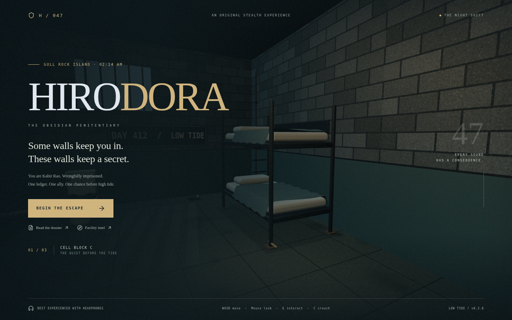
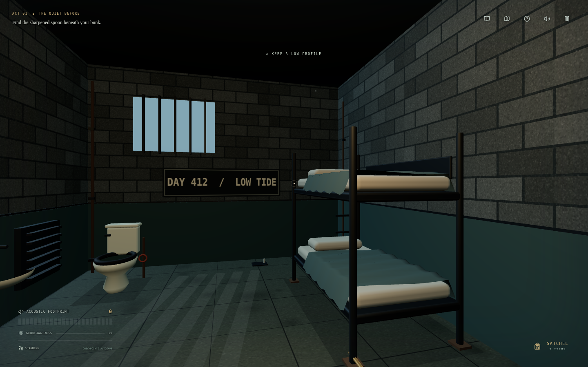
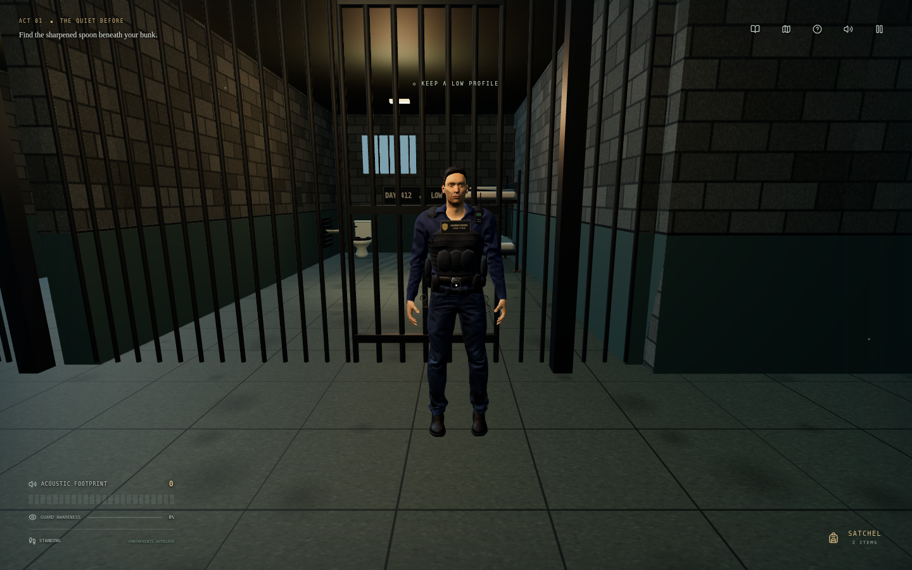
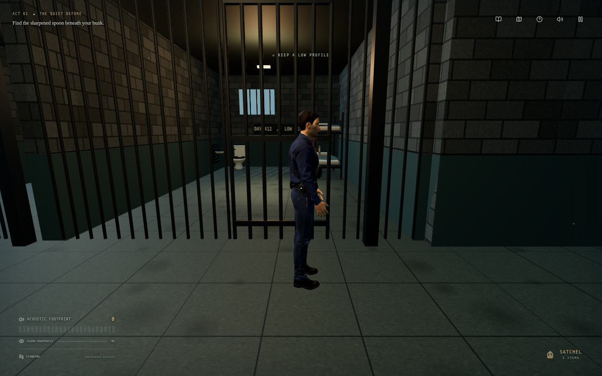
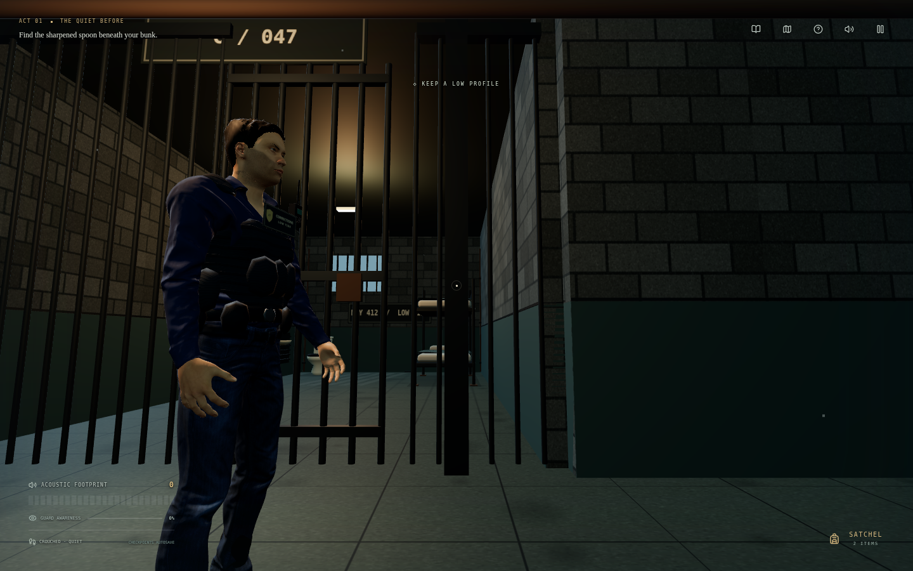
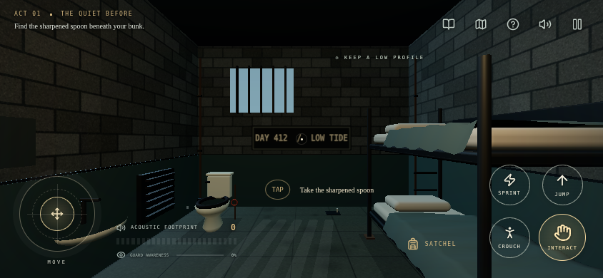
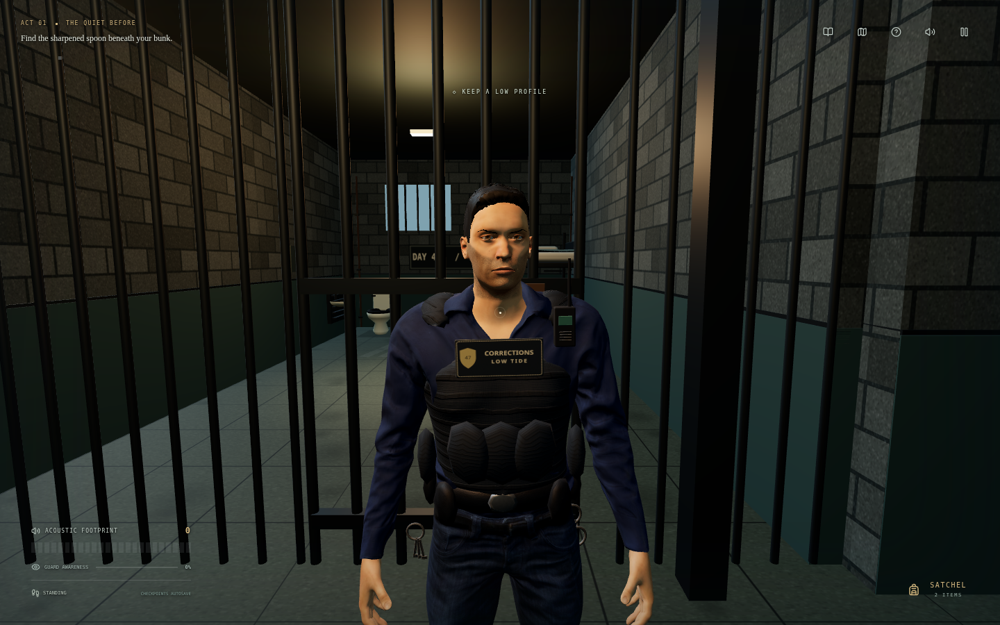

<div align="center">


# H I R O D O R A

### THE OBSIDIAN PENITENTIARY

**Some walls keep you in. These walls keep a secret.**

**v0.3.0 · The Human Element**

An original first-person prison escape · Acoustic stealth · Three endings

**[↓ DOWNLOAD THE LATEST OFFLINE GAME — v0.3.0 ZIP](https://github.com/Rememberfrxst/Hirodora/raw/refs/heads/main/downloads/Hirodora-0.3.0-offline.zip)**

[Single-file HTML](https://github.com/Rememberfrxst/Hirodora/raw/refs/heads/main/downloads/Hirodora-0.3.0.html) · [Mobile setup](#play-on-mobile) · [Checksums](downloads/latest.json)

[The experience](#the-experience) · [Play on mobile](#play-on-mobile) · [Development](#development) · [Quality](#quality-and-release-status)



</div>

## One ledger. One ally. One chance.

You are **Kabir Rao**, a vault technician imprisoned by the man whose secrets you discovered. Warden Voss runs Gull Rock like a kingdom. Officer Iyer is ready to bring it down—if you can get her the smuggling ledger.

A key arrives through the meal slot. The sea is pulling back. Tonight is your way out.

> **Every sound has a consequence.** Crouch through the cell block, use running machinery to mask your movement, and break a guard’s line of sight before suspicion becomes pursuit.

## The experience

| Atmosphere                                                                                         | Systems                                                                                  |
| :------------------------------------------------------------------------------------------------- | :--------------------------------------------------------------------------------------- |
| Barred cells, worn masonry, service pipes and warm practical lighting                              | Solid walls, locked gates, line-of-sight checks and guard routing                        |
| Rounded mattresses, draped blankets and modeled porcelain fixtures                                 | A complete route through cells, infirmary, laundry, maintenance, office and tidal tunnel |
| Full-body CC0 human officers, fitted navy uniforms, photo skin and 69-bone skeletal rigs           | Blended idle, mocap walk/run, turns, investigation, searching, alert and collapse         |
| Material-based sound transients, water, footsteps, metal and radio cues                            | Stereo guard footsteps, zone ambience, sound masking and volume controls                 |
| Transparent field HUD, unboxed utility icons, touch action cluster, story dossier and facility map | Keyboard/mouse and touch controls, checkpoints, hints and reduced camera motion          |



### Work quietly. Think ahead.

Find the sharpened spoon. Open the service duct. Earn Boulder’s respect at the arm-wrestling table. Search the utility wing for tools, craft a suppressor, and listen your way into Voss’s vault. The **four-minute tidal countdown** begins when you recover the ledger.

<table>
<tr><td width="50%"></td><td width="50%"></td></tr>
<tr><td align="center"><sub>FRONT · AUTHORED HUMAN ANATOMY</sub></td><td align="center"><sub>SIDE · FITTED UNIFORM AND DUTY GEAR</sub></td></tr>
<tr><td></td><td></td></tr>
<tr><td align="center"><sub>IN GAME · PATROL SIMULATION RUNNING</sub></td><td align="center"><sub>MOBILE · LANDSCAPE RECOMMENDED</sub></td></tr>
</table>

All screenshots are actual v0.3.0 browser renders. Front/side/detail showcases stage the camera and pose inside the real prison; the gameplay shot runs guard AI. The old primitive patrol bodies are replaced by embedded, skinned GLBs with detailed fingers, eyes, short hair, authored clothing and textures. Radio, identification, handcuffs and keys follow their attachment bones. [Sources, licenses and implementation](docs/GUARD-ASSETS.md).

<details><summary>Inspect the new guard face and duty uniform</summary>



</details>

### Three ways to leave Gull Rock

| Ending          | Your choice                                        |
| :-------------- | :------------------------------------------------- |
| **Ghost**       | Escape without triggering an alarm.                |
| **Loud**        | Reach the skiff after the prison has been alerted. |
| **Brotherhood** | Return for Boulder in the tidal tunnel.            |

## Play on mobile

### Download v0.3.0 — offline edition

**[Download Hirodora v0.3.0 for offline play (.zip, approximately 4.6 MiB)](https://github.com/Rememberfrxst/Hirodora/raw/refs/heads/main/downloads/Hirodora-0.3.0-offline.zip)**

1. Download the ZIP from the link above and extract it in your device’s Files app.
2. Open **`Hirodora-0.3.0.html` in a full WebGL 2 browser**, such as Chrome on Android. If your file viewer displays text or blocks scripts, choose “Open with” a full browser. File handling depends on the device/browser.
3. Play in landscape: left joystick to move, drag the scene to look, then use **Jump**, **Crouch / Stand**, **Sprint**, **Interact** and the contextual action prompt.

The single HTML embeds the engine, **all three officer GLBs and textures**, styles and synthesized audio. It needs **no server, API key, external model download or network**. Wait for officer model preparation to finish before starting. The unmodified standalone document is tested in offline Chromium mobile emulation with zero HTTP requests. Direct file navigation is blocked by this cloud browser’s administrator policy, so device file-opening behavior still needs physical-phone testing. This is a web game, **not an APK or IPA**.

The same download works on desktop: extract and open the HTML in Chrome, Edge or Firefox. The conventional `dist/index.html` is a different, hosted build and still requires an HTTP server.

### iPhone/iPad and Home Screen installation

For iOS, use the **hosted PWA**: local HTML previews often block scripts. Once a maintainer publishes the included Pages workflow, open the deployment’s HTTPS address in Safari → **Share → Add to Home Screen**. On Android, the same hosted build supports Chrome’s **Install app / Add to Home screen**.

Let the first online load finish caching. Subsequent reloads can run offline. Checkpoints stay in that browser/device; clearing site storage removes them. A recent browser with **WebGL 2** is required. Audio begins after a user interaction.

**Publishing:** Settings → Pages → select **GitHub Actions**, then run **Publish playable game to GitHub Pages** from Actions. Use the URL returned by the successful deployment. No live deployment is claimed here.

The latest version and SHA-256 archive checksum are recorded in [downloads/latest.json](downloads/latest.json). CI also uploads `hirodora-mobile-offline` and `hirodora-web` build artifacts.

## Controls

| Action                    | Desktop                                       | Touch                                |
| :------------------------ | :-------------------------------------------- | :----------------------------------- |
| Move                      | W A S D                                       | Left joystick                        |
| Look                      | Mouse after clicking the scene; drag fallback | Drag the scene                       |
| Interact / leave cover    | E                                             | Interact button or contextual prompt |
| Crouch / stand            | C                                             | Crouch / Stand toggle                |
| Jump                      | Space                                         | Jump button                          |
| Sprint                    | Shift                                         | Sprint toggle                        |
| Fire equipped dart pistol | Click while mouse is captured                 | Dart button                          |
| Hint                      | H                                             | Question-mark icon                   |
| Facility map / story      | M / L                                         | Map / book icons                     |
| Inventory                 | Satchel button                                | Satchel button                       |
| Pause                     | Esc / P                                       | Pause icon                           |
| Mute                      | U                                             | Speaker icon                         |

Jumping is a low hop with a landing sound/noise cost; it cannot bypass locked gates or solid walls. Touch actions use distinct 44px-or-larger targets, a radial joystick with a dead zone, and visible crouch/sprint toggle states. Objective text, subtitles, awareness text and top-right icons have no gray panel backgrounds.

The pause menu includes master volume, look sensitivity, reduced camera motion and **Automatic / Desktop / Mobile officer quality**. Hero and mobile models share textures/geometry across instances, with a distant LOD and independent skeletal mixers. Desktop quality enables a practical-fixture shadow map; automatic mode selects balanced settings for touch/software devices. Puzzle alignment has visual feedback as well as audio cues. Hints have a 20-second cooldown. Returning from a puzzle releases mouse capture; click the scene to capture it again.

## Development

Requires **Node.js 24** and **Bun 1.4.4**. No API keys, database, remote asset server or paid service is required for gameplay.

```sh
git clone https://github.com/Rememberfrxst/Hirodora.git
cd Hirodora
bun install --frozen-lockfile
npm run dev
```

Without a global Bun installation, use `npm exec --yes bun@1.4.4 -- install --frozen-lockfile`. In a restricted cloud workspace, add `--cache /tmp/hirodora-npm-cache` immediately after `npm` if the default npm cache is unavailable.

```sh
npm run check          # TypeScript, logic/navigation tests, production + offline build
node scripts/package-mobile.mjs # Refresh the downloadable standalone build
npx playwright install chromium
npm run test:e2e       # Browser integration tests
npm run preview       # Serve the production output
npm run package:mobile # Build the versioned single-file offline download
```

For an existing system Chromium, set `PLAYWRIGHT_CHROMIUM_EXECUTABLE=/path/to/chromium` when running browser tests. Tests manage separate development and production servers on ports 3100 and 3101.

### Build and distribute

`npm run build` produces `dist/`, a content-versioned service worker, relative asset paths for GitHub Pages subdirectories, embedded-texture GLBs, PNG app icons and the install manifest. Only assets required by the game are copied into the playable build. The offline payload is approximately **7.02 MiB uncompressed** in this revision; the build still fails if it exceeds **8 MiB**.

The quality workflow checks pull requests and pushes, packages the offline HTML, runs browser tests and uploads both builds. Static surfaces are batched, Meshopt/WebP reduce model transfer size, instances share GPU resources, distant animations are throttled and offscreen pose work is skipped. Light selection is throttled, collision bounds are cached and mobile resolution scales down under sustained rendering load. The Pages workflow is manual so publishing remains an explicit release action. Normal builds use committed assets; [rebuilding the officer GLBs](docs/GUARD-ASSETS.md#rebuild-the-assets) is a separate offline-authoring step.

## Quality and release status

This is a working, substantially rebuilt **playable web slice**, with automated regression coverage. It is not a guarantee of zero defects or a claim of completed device certification.

- **20 asset/logic tests** cover embedded PBR maps, skin weights, bone indices, clips, animation selection, stealth, puzzles, crafting, endings, movement, routing clearance and the jump arc.
- **Eight browser scenarios** exercise independent rigs, shared geometry, real joint movement, patrol, LOD, darts/collapse, checkpoint reset, failed-download retry, desktop/touch controls, transparent HUD, all puzzles, progression and both hosted/downloaded offline play.
- The progression integration test uses legal approach-position fixtures with patrols suspended; it is not a full unassisted stealth playthrough.
- Physical Android/iPhone testing, Safari/Firefox checks, sustained performance testing and player-led difficulty balancing remain release gates.

See [development notes and the hardware QA checklist](docs/DEVELOPMENT.md) for architecture, the initial defects found, test boundaries and screenshot reproduction.

## Credits and assets

Built with React, TypeScript, Three.js, Vite, Lucide and Web Audio. Full-body human assets, photo skin and authored clothing derive from **MakeHuman CC0**, fitted/exported with the MIT Ara pipeline. Walk/run use CMU motion capture; other poses combine pipeline keyframes with project-authored investigation/search/alert. The data used in this project was obtained from mocap.cs.cmu.edu; the database was created with funding from NSF EIA-0196217. [Complete sources, terms and modifications](docs/GUARD-ASSETS.md). Prison geometry, additional duty equipment, prop details, sound synthesis and app icons are project work. Supporting NPCs retain the older articulated bodies. No GTA/Rockstar assets were extracted or reused; the visual reference does not imply GTA 6 fidelity.

<div align="center"><sub>HIRODORA · GULL ROCK PENITENTIARY · EVERY SOUND HAS A CONSEQUENCE.</sub></div>
