<div align="center">


# H I R O D O R A

### THE OBSIDIAN PENITENTIARY

**Some walls keep you in. These walls keep a secret.**

**v0.7.0 · Custom HUD / New Officer**

First-person prison escape · Recorded spatial audio · New Cell 47 → 46 chapter

**[↓ DOWNLOAD ANDROID APK — v0.7.0](https://github.com/Rememberfrxst/Hirodora/raw/refs/heads/main/downloads/Hirodora-0.7.0-android.apk)**

[Offline web ZIP](https://github.com/Rememberfrxst/Hirodora/raw/refs/heads/main/downloads/Hirodora-0.7.0-offline.zip) · [Single-file HTML](https://github.com/Rememberfrxst/Hirodora/raw/refs/heads/main/downloads/Hirodora-0.7.0.html) · [APK checksums](downloads/android-latest.json) · [Android build and signing](docs/ANDROID.md)

[The experience](#the-experience) · [Play on mobile](#play-on-mobile) · [Development](#development) · [Quality](#quality-and-release-status)

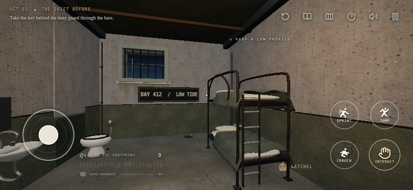

</div>

## Android app / 0.7.0

**Pause → Custom HUD** opens a live layout editor. Choose Compact, Left-handed or Large buttons, drag any of six touch controls, select a control to resize it, then Save HUD. Cancel discards edits; Reset restores the selected preset. Layouts stay on the device, independently of New Game/checkpoint saves. Display cutouts and screen edges constrain the buttons. The joystick now has a solid thumb dot and travel ring. Inventory has numbered item cards and an empty state.

The new officer is rebuilt from licensed MakeHuman anatomy and fitted photographic clothing: revised face/body, short hair, work shirt, breast shield, shoulder epaulettes, radio and utility belt. The bulky padded vest and overlapping boot shafts are removed. Hero/mobile/distant GLBs retain the 69-bone rig and gameplay animations; walk/run changes preserve stride phase. [Asset sources and exact geometry counts](docs/GUARD-ASSETS.md).

<table>
<tr><td width="50%">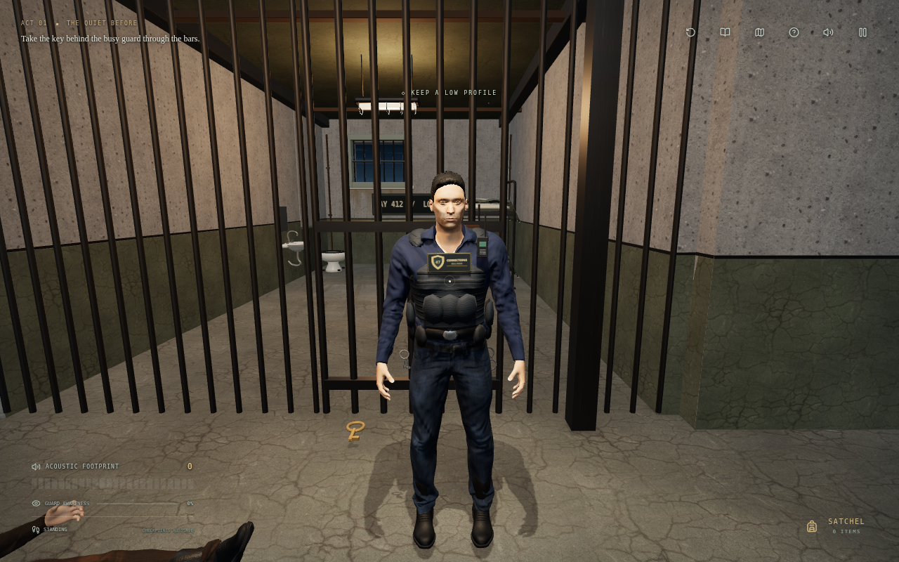</td><td width="50%"></td></tr>
<tr><td align="center"><sub>BEFORE · 0.6.0</sub></td><td align="center"><sub>AFTER · 0.7.0 · SAME CAMERA</sub></td></tr>
<tr><td>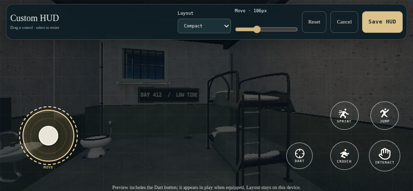</td><td>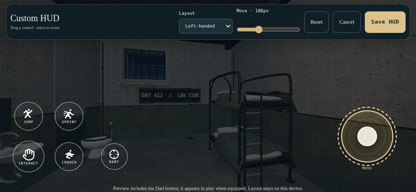</td></tr>
<tr><td>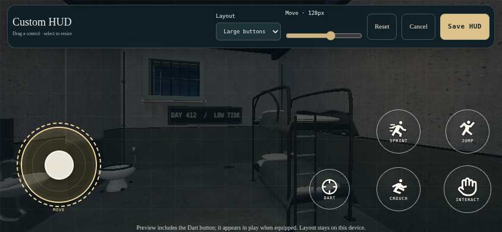</td><td>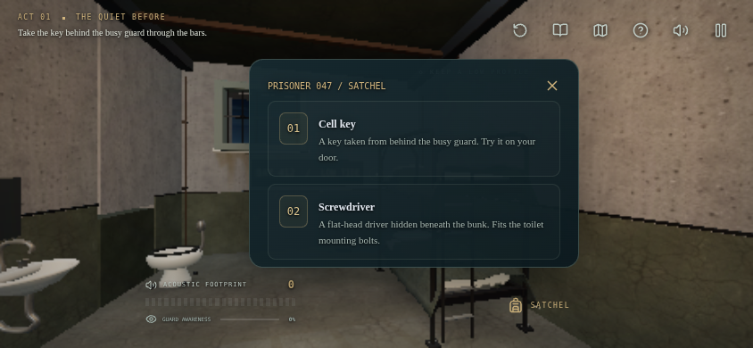</td></tr>
</table>

**Still pending from the requested visual brief:** the supplied `rock_wall_17_1k.blend` opens with Blender 5.2, but its four image maps are external and absent. The official `dl.polyhaven.org` downloads still return proxy CONNECT HTTP 403. Existing licensed concrete remains in the game. The three original action PNGs were referenced by desktop paths unavailable to this cloud workspace; current buttons use project-authored temporary silhouettes. The exact rock finish and original PNG artwork are **not included** in this release. [Exact missing files, licenses and inspection evidence](docs/HUD-V7.md).

Install the signed APK on **Android 8.0 or newer** with an updated Android System WebView. Allow installation from your browser/Files app when prompted. The game opens in landscape and runs offline with all models, textures and recordings included. No Internet or storage permission is requested. Android Back/backgrounding pauses the escape; return and tap Resume. [Installation, build instructions, signing identity and limitations](docs/ANDROID.md).

**New controls:** use the HUD restart icon to retry a checkpoint, or **Pause → Start new game** to return to Cell 47 with a fresh inventory. Replacing progress asks for confirmation. Cell 47 is quiet at rest: the continuous ventilation loop and random water playback have been removed from this zone. Guard dialogue has a deeper processed voice master and clearer spatial mixing.

### Previous environment milestone · 0.6

<table>
<tr><td width="50%">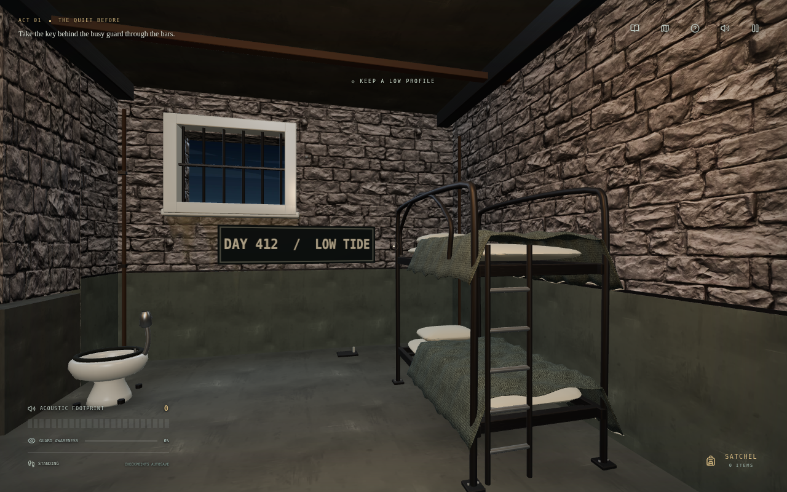</td><td width="50%">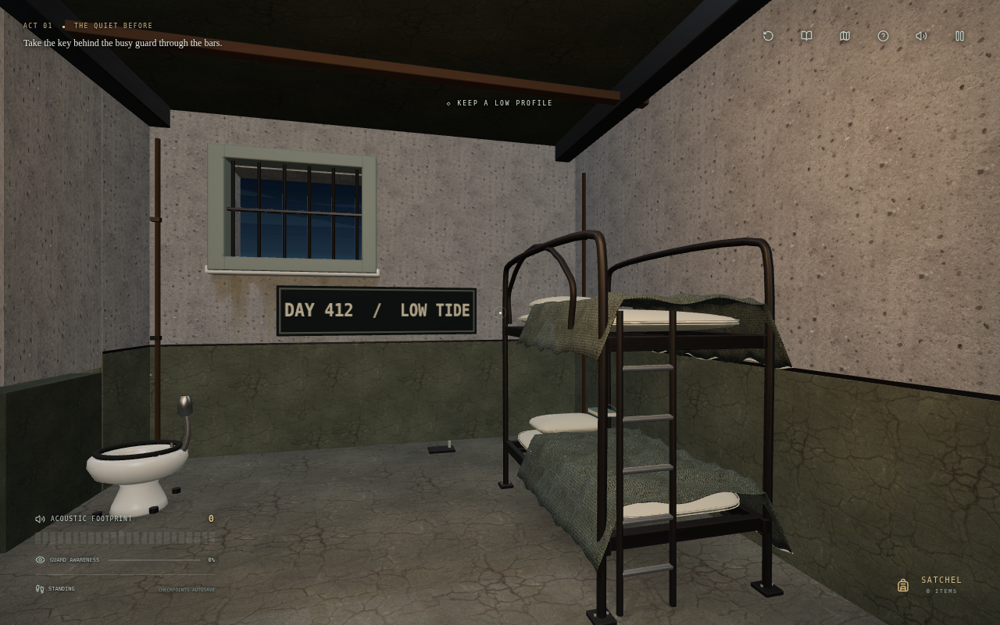</td></tr>
<tr><td align="center"><sub>BEFORE · 0.5.0</sub></td><td align="center"><sub>AFTER · 0.6.0 · SAME CAMERA</sub></td></tr>
<tr><td></td><td>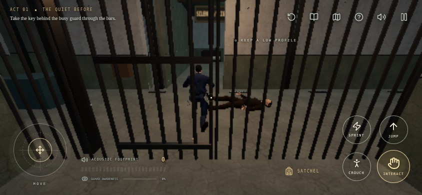</td></tr>
<tr><td>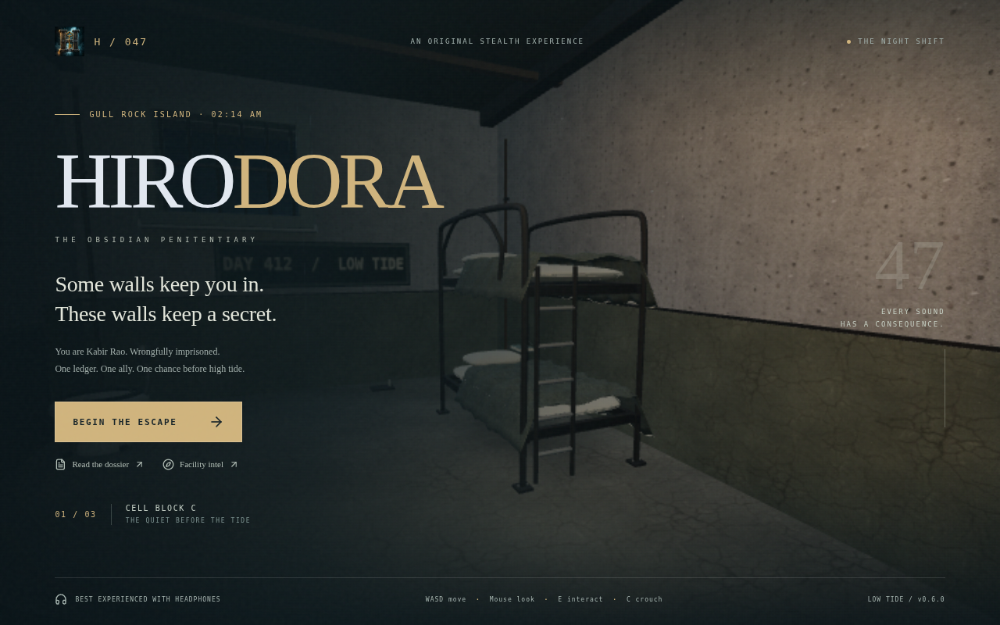</td><td>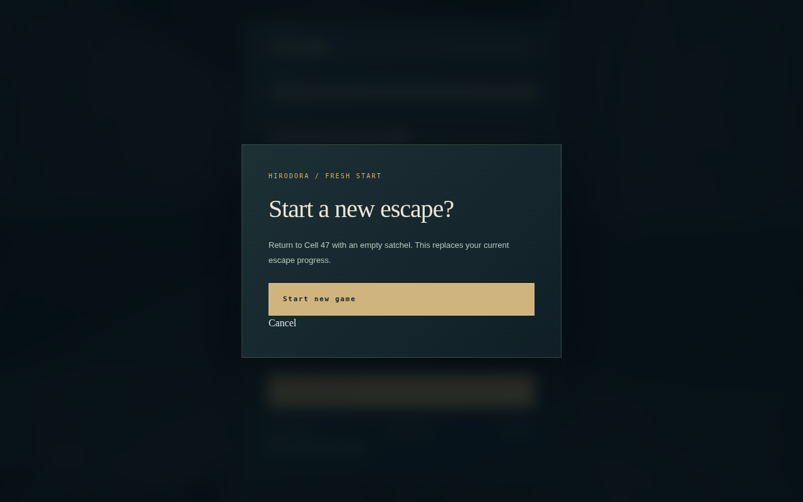</td></tr>
</table>

New concrete photographs and source normal maps are by **p0ss / Georges Grondin**, CC-BY 3.0; roughness/AO are documented adaptations. [Source and license](src/assets/environment/CONCRETE-LICENSE.txt). Existing environment galleries below are retained as historical milestones.

## New opening: a way through

A prisoner lies dead outside Cell 47. An officer is busy examining him. A key lies behind the officer, within reach through the bars. Collect it quietly. It looks like your chance to open the door—but the lock reveals the truth: **the key belongs to Cell 42**.

Push the bunk slowly to uncover a screwdriver. Unbolt the toilet on the shared wall, move it aside, and use **Penetrate** to enter Cell 46. Your chapter checkpoint is saved there, and the passage works both ways. Cells **45, 44, 43 and 42** are physically present and locked for a future chapter. Existing v2 saves still load the original campaign.

<table>
<tr><td width="50%">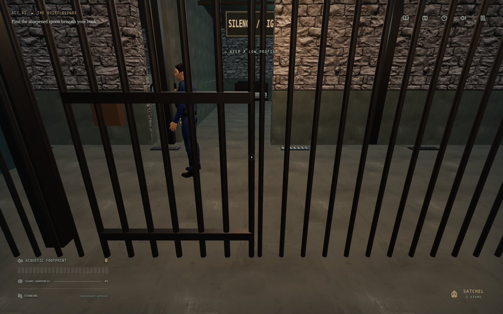</td><td width="50%">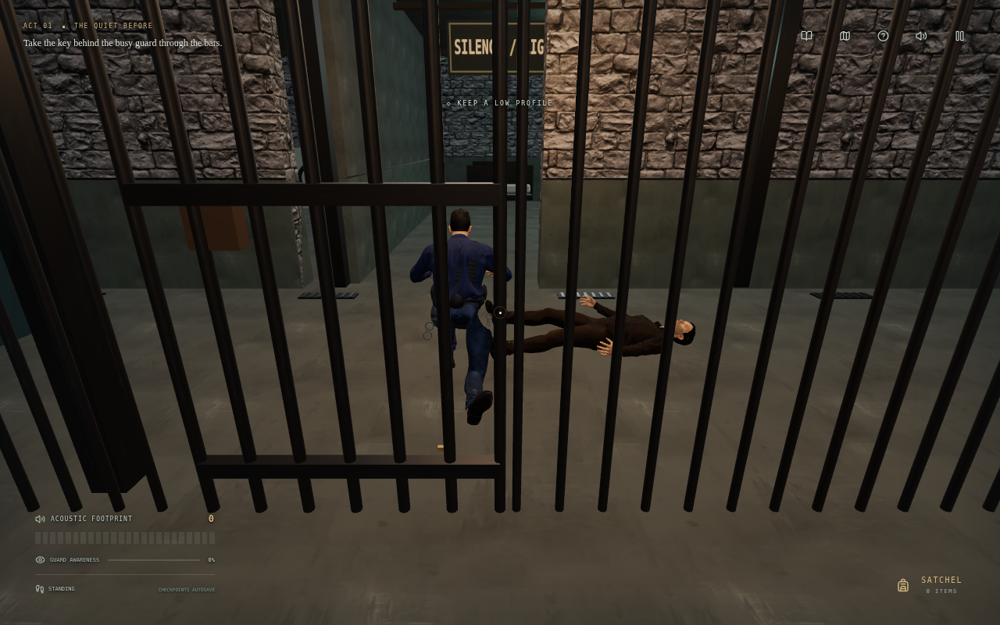</td></tr>
<tr><td align="center"><sub>BEFORE · 1e463ed</sub></td><td align="center"><sub>AFTER · NEW OPENING</sub></td></tr>
<tr><td>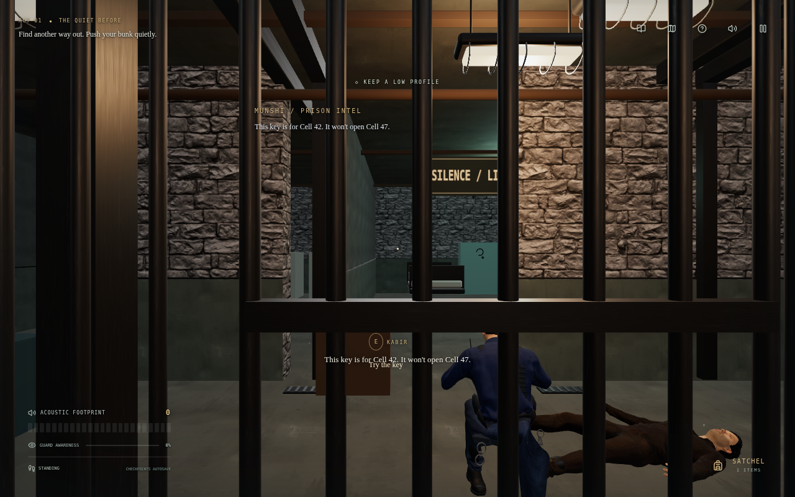</td><td>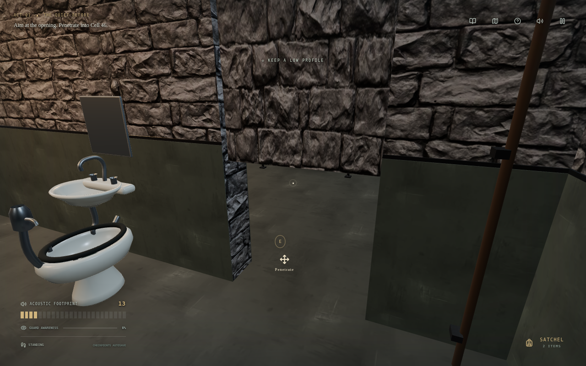</td></tr>
</table>

These are actual browser renders. [Capture cameras and progress](docs/screenshots/opening/capture.json) document the comparison. Capture tooling advances the normal interaction simulation with a fixed timestep for the puzzle views.

### How to finish this chapter

1. Approach the bars while the officer checks the body. Aim at the key and press **E** or tap **Interact**.
2. Aim at Cell 47's lock and try the key. Read the notice; the key remains in your satchel as **Cell 42 key**.
3. Aim at the bunk. **Hold E / Push** to move it quietly. **Hold R / Push hard** moves it faster and attracts the guard.
4. Pick up the screwdriver revealed beneath the bunk.
5. Hold the action on the toilet's mounting bolts, then hold **Move toilet**.
6. Aim at the opening and use **Penetrate**. Reach Cell 46 to complete this chapter. Choose **Explore Cell 46** to inspect the cell or return through the passage.

### Recorded audio

**59 CC0 recordings, 803 KiB**: material footsteps, keys, bed dragging, screwdriver, ceramic scraping, hinges, paper, fabric, zone-specific ventilation/water and processed English guard speech. Footsteps follow real ground movement; guards use distance attenuation, spatial panning and wall filtering. Pause settings provide separate sound, footstep, ambience, dialogue, music and UI levels. [Audio sources, licenses, audit and remaining work](docs/AUDIO.md).

The recorded lines are “Hey, you can't do that!” and “Stop right there. This isn't over yet!” Custom “I'm coming to check / for you” performances, exterior ambience and physical-phone audio QA remain pending. This release does not claim the entire sound-design brief is finished.

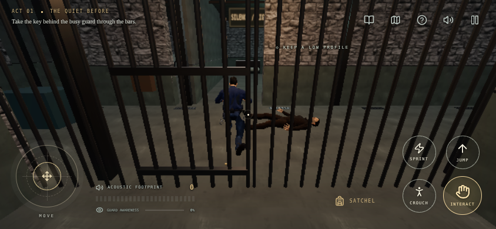

<details><summary>Cell 46 checkpoint and the extended cell block</summary>

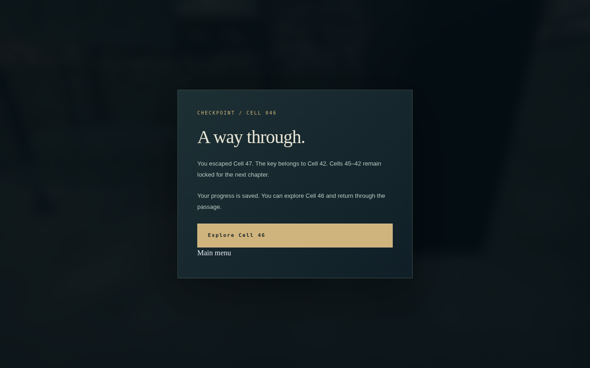
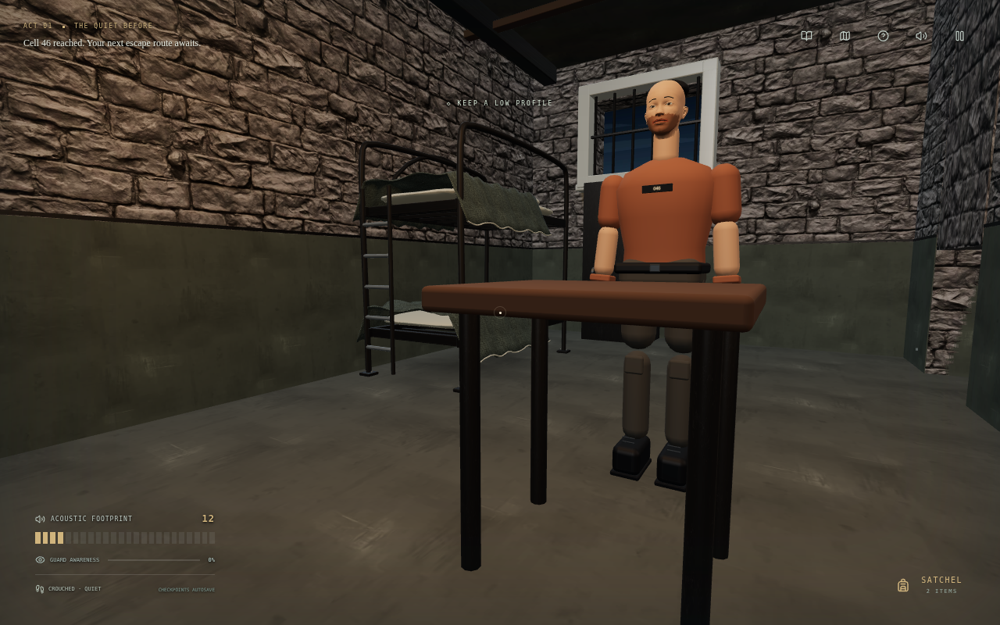
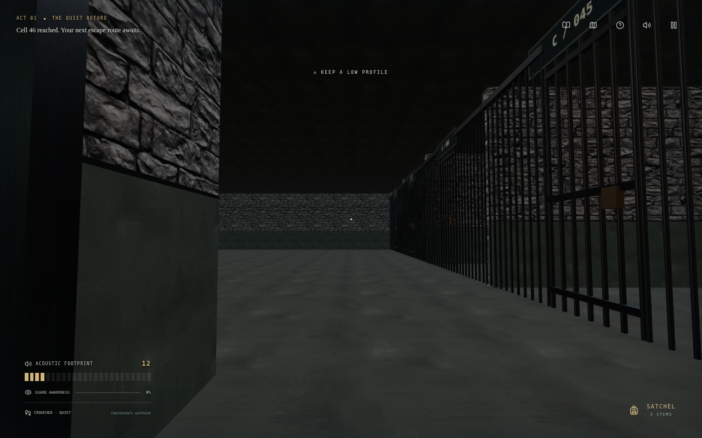

</details>

## Cell 47 environment preview

Version 0.4.0 includes authored Blender/GLB cell furniture, sourced PBR masonry/metal/fabric maps, real window apertures and a window shadow light. [Sources, licenses, matched renders and remaining work](docs/ENVIRONMENT-ASSETS.md).


<table>
<tr><td width="50%">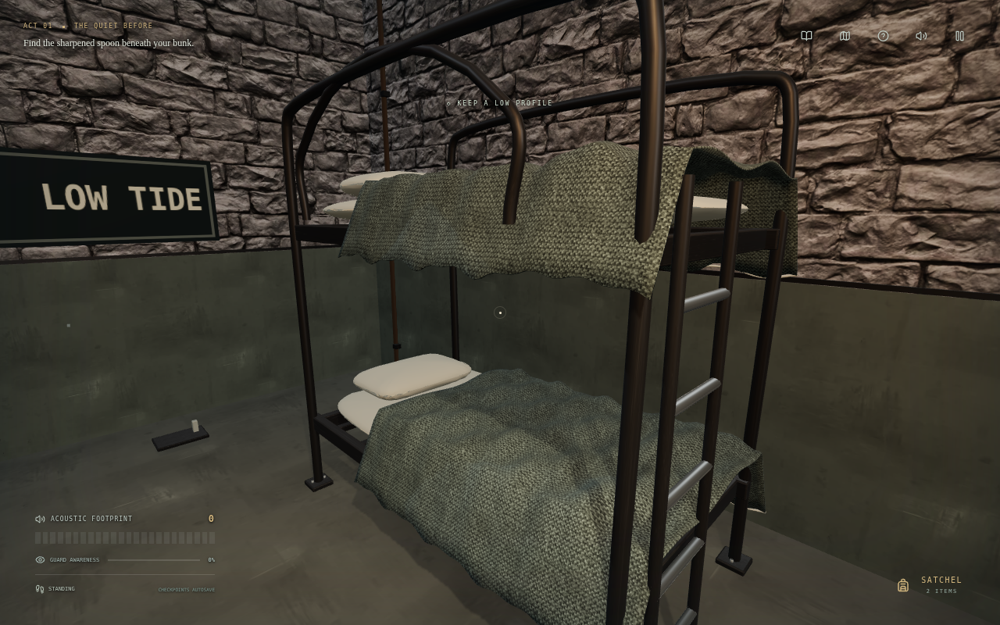</td><td width="50%">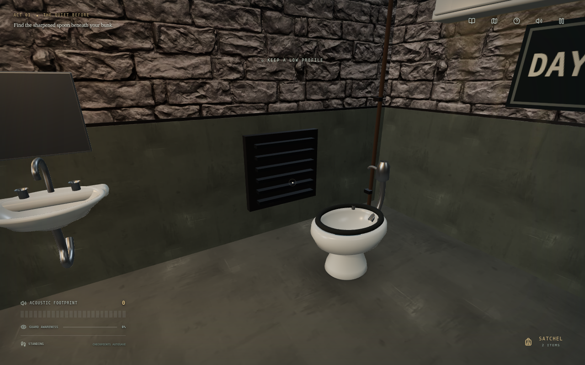</td></tr>
<tr><td align="center"><sub>CELL 47 · BUNK AND FABRIC</sub></td><td align="center"><sub>CELL 47 · SANITARY FIXTURES</sub></td></tr>
<tr><td>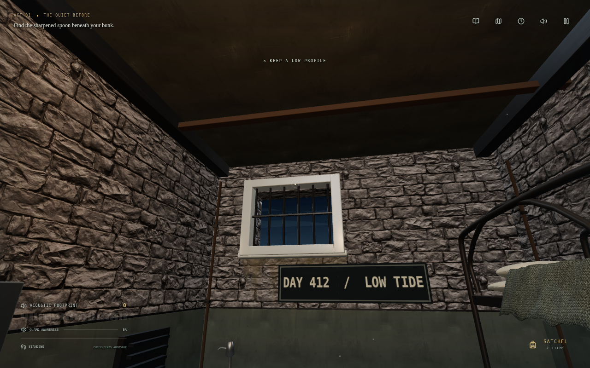</td><td>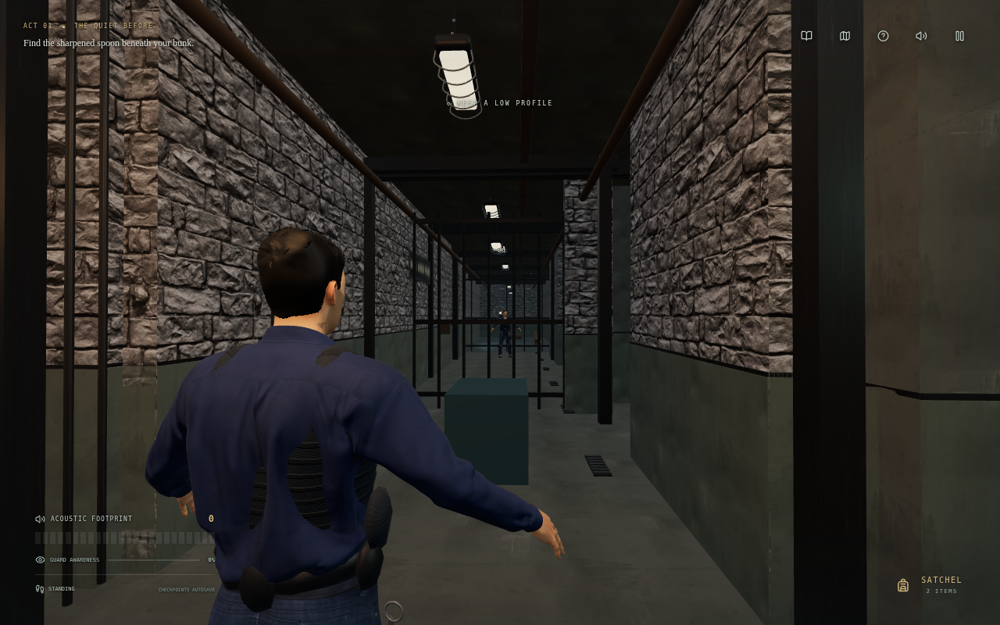</td></tr>
<tr><td align="center"><sub>WINDOW · REVEALS AND CEILING</sub></td><td align="center"><sub>BLOCK C · CORRIDOR</sub></td></tr>
</table>

This historical 0.4 preview used adapted worn-surface maps. Version 0.6 replaces them with the photographed concrete and source normals described above. Physical-phone QA remains open.

## One ledger. One ally. One chance.

You are **Kabir Rao**, a vault technician imprisoned by the man whose secrets you discovered. Warden Voss runs Gull Rock like a kingdom. Officer Iyer is ready to bring it down—if you can get her the smuggling ledger.

A key lies behind a distracted officer. The sea is pulling back. Tonight is your way out.

> **Every sound has a consequence.** Crouch through the cell block, use running machinery to mask your movement, and break a guard’s line of sight before suspicion becomes pursuit.

## The experience

| Atmosphere                                                                                         | Systems                                                                                  |
| :------------------------------------------------------------------------------------------------- | :--------------------------------------------------------------------------------------- |
| Barred cells, worn masonry, service pipes and warm practical lighting                              | Solid walls, locked gates, line-of-sight checks and guard routing                        |
| Rounded mattresses, draped blankets and modeled porcelain fixtures                                 | A complete route through cells, infirmary, laundry, maintenance, office and tidal tunnel |
| Full-body CC0 human officers, fitted navy uniforms, photo skin and 69-bone skeletal rigs           | Blended idle, mocap walk/run, turns, investigation, searching, alert and collapse         |
| Material-based sound transients, water, footsteps, metal and radio cues                            | Stereo guard footsteps, zone ambience, sound masking and volume controls                 |
| Transparent field HUD, unboxed utility icons, touch action cluster, story dossier and facility map | Keyboard/mouse and touch controls, checkpoints, hints and reduced camera motion          |


### Work quietly. Think ahead.

New games follow the Cell 47 → 46 opening above. The original campaign remains available through existing v2 checkpoints: spoon, service duct, Boulder, utility-wing crafting and Voss’s vault. Its **four-minute tidal countdown** begins when you recover the ledger.

<table>
<tr><td width="50%"></td><td width="50%"></td></tr>
<tr><td align="center"><sub>FRONT · AUTHORED HUMAN ANATOMY</sub></td><td align="center"><sub>SIDE · FITTED UNIFORM AND DUTY GEAR</sub></td></tr>
<tr><td></td><td></td></tr>
<tr><td align="center"><sub>IN GAME · PATROL SIMULATION RUNNING</sub></td><td align="center"><sub>MOBILE · LANDSCAPE RECOMMENDED</sub></td></tr>
</table>

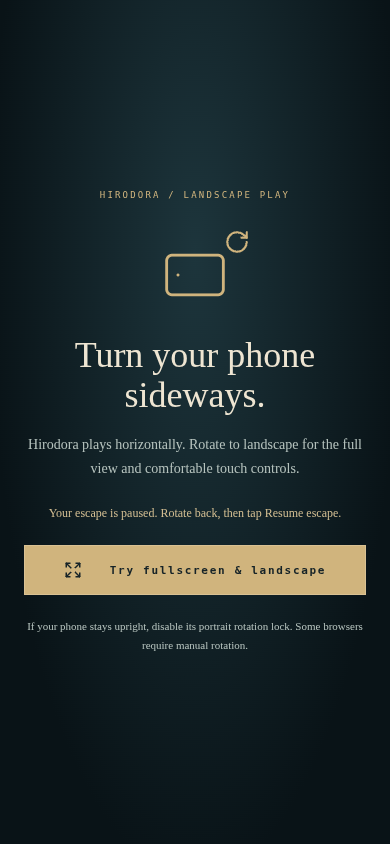

The gallery shows actual v0.4.0 browser renders. Front/side/detail showcases stage the camera and pose inside the real prison; the gameplay shot runs guard AI. The matched before/after comparison uses the 5a21adc baseline. Officers use embedded, skinned GLBs with detailed fingers, eyes, short hair, authored clothing and textures. Radio, identification, handcuffs and keys follow their attachment bones. [Sources, licenses and implementation](docs/GUARD-ASSETS.md).

<details><summary>Inspect the new guard face and duty uniform</summary>


</details>

### Three ways to leave Gull Rock

| Ending          | Your choice                                        |
| :-------------- | :------------------------------------------------- |
| **Ghost**       | Escape without triggering an alarm.                |
| **Loud**        | Reach the skiff after the prison has been alerted. |
| **Brotherhood** | Return for Boulder in the tidal tunnel.            |

## Play on mobile

### Android APK — recommended

**[Download Hirodora v0.7.0 APK](https://github.com/Rememberfrxst/Hirodora/raw/refs/heads/main/downloads/Hirodora-0.7.0-android.apk)**. Install from Files, then launch Hirodora. Android 8.0+ and an updated System WebView are required. The APK automatically opens in landscape; it includes the complete offline game. It uses the same signing identity as 0.6 and a higher version code, so install it over that version to retain app-local saves and settings.

### Browser offline edition

**[Download Hirodora v0.7.0 web ZIP](https://github.com/Rememberfrxst/Hirodora/raw/refs/heads/main/downloads/Hirodora-0.7.0-offline.zip)**

1. Download the ZIP from the link above and extract it in your device’s Files app.
2. Open **`Hirodora-0.7.0.html` in a full WebGL 2 browser**, such as Chrome on Android. If your file viewer displays text or blocks scripts, choose “Open with” a full browser. File handling depends on the device/browser.
3. Play in landscape: left joystick to move, drag the scene to look, then use **Jump**, **Crouch / Stand**, **Sprint**, **Interact** and the contextual action prompt. Portrait now shows a Rotate screen and pauses gameplay; rotate back to landscape and tap **Resume escape**. Puzzle progress is kept.

Use **Fullscreen / landscape** on the title screen or pause menu to request fullscreen and landscape on supported Android browsers. Browser security prevents a web game from forcing rotation everywhere: if it remains portrait, disable the phone’s portrait-orientation lock and rotate manually. iPhone/iPad browsers may require manual rotation.

The single HTML embeds the engine, **all three officer GLBs and textures**, styles and recorded audio. It needs **no server, API key, external model download or network**. Wait for officer model preparation to finish before starting. The standalone document is tested in offline Chromium mobile emulation with zero HTTP requests. This web download is separate from the Android APK; iOS uses the hosted PWA.

The same download works on desktop: extract and open the HTML in Chrome, Edge or Firefox. The conventional `dist/index.html` is a different, hosted build and still requires an HTTP server.

### iPhone/iPad and Home Screen installation

For iOS, use the **hosted PWA**: local HTML previews often block scripts. Once a maintainer publishes the included Pages workflow, open the deployment’s HTTPS address in Safari → **Share → Add to Home Screen**. On Android, the same hosted build supports Chrome’s **Install app / Add to Home screen**.

Let the first online load finish caching. Subsequent reloads can run offline. Checkpoints stay in that browser/device; clearing site storage removes them. A recent browser with **WebGL 2** is required. Audio begins after a user interaction.

**Publishing:** Settings → Pages → select **GitHub Actions**, then run **Publish playable game to GitHub Pages** from Actions. Use the URL returned by the successful deployment. No live deployment is claimed here.

The latest version and SHA-256 archive checksum are recorded in [downloads/latest.json](downloads/latest.json). CI also uploads `hirodora-mobile-offline` and `hirodora-web` build artifacts.

## Controls

| Action                    | Desktop                                       | Touch                                |
| :------------------------ | :-------------------------------------------- | :----------------------------------- |
| Move                      | W A S D                                       | Left joystick                        |
| Look                      | Mouse after clicking the scene; drag fallback | Drag the scene                       |
| Interact / leave cover    | E                                             | Interact button or contextual prompt |
| Crouch / stand            | C                                             | Crouch / Stand toggle                |
| Jump                      | Space                                         | Jump button                          |
| Sprint                    | Shift                                         | Sprint toggle                        |
| Fire equipped dart pistol | Click while mouse is captured                 | Dart button                          |
| Hint                      | H                                             | Question-mark icon                   |
| Facility map / story      | M / L                                         | Map / book icons                     |
| Inventory                 | Satchel button                                | Satchel button                       |
| Pause                     | Esc / P                                       | Pause icon                           |
| Mute                      | U                                             | Speaker icon                         |

Jumping is a low hop with a landing sound/noise cost; it cannot bypass locked gates or solid walls. Touch actions use distinct 44px-or-larger targets, a radial joystick with a dead zone, and visible crouch/sprint toggle states. Objective text, subtitles, awareness text and top-right icons have no gray panel backgrounds.

The pause menu includes master volume, look sensitivity, reduced camera motion and **Automatic / Desktop / Mobile officer quality**. Hero and mobile models share textures/geometry across instances, with a distant LOD and independent skeletal mixers. Desktop quality enables a practical-fixture shadow map; automatic mode selects balanced settings for touch/software devices. The graphics preset now starts conservatively on touch, low-memory, low-core and software-rendered devices, then adjusts render resolution in small steps from measured render time. The pause menu shows the active render scale and draw-call count; use **Low** or **Medium** first if it is optimizing continuously. Puzzle alignment has visual feedback as well as audio cues. Hints have a 20-second cooldown. Returning from a puzzle releases mouse capture; click the scene to capture it again.

## Development

Requires **Node.js 24** and **Bun 1.4.4**. No API keys, database, remote asset server or paid service is required for gameplay.

```sh
git clone https://github.com/Rememberfrxst/Hirodora.git
cd Hirodora
bun install --frozen-lockfile
npm run dev
```

Without a global Bun installation, use `npm exec --yes bun@1.4.4 -- install --frozen-lockfile`. In a restricted cloud workspace, add `--cache /tmp/hirodora-npm-cache` immediately after `npm` if the default npm cache is unavailable.

```sh
npm run check          # TypeScript, logic/navigation tests, production + offline build
node scripts/package-mobile.mjs # Refresh the downloadable standalone build
npx playwright install chromium
npm run test:e2e       # Browser integration tests
npm run preview       # Serve the production output
npm run package:mobile # Build the versioned single-file offline download
```

For an existing system Chromium, set `PLAYWRIGHT_CHROMIUM_EXECUTABLE=/path/to/chromium` when running browser tests. Tests manage separate development and production servers on ports 3100 and 3101.

### Build and distribute

`npm run build` produces `dist/`, a content-versioned service worker, relative asset paths for GitHub Pages subdirectories, embedded-texture GLBs, PNG app icons and the install manifest. The v0.7 hosted payload is approximately **12.2 MiB**; the build enforces a **100 MiB** maximum. `npm run package:android` creates and verifies the signed Android APK. Exact sizes and checksums are recorded in the download manifests.

The quality workflow checks pull requests and pushes, packages the offline HTML, runs browser tests and uploads both builds. Static surfaces are batched, Meshopt/WebP reduce model transfer size, instances share GPU resources, distant animations are throttled and offscreen pose work is skipped. Light selection is throttled, collision bounds are cached and mobile resolution scales down under sustained rendering load. The Pages workflow is manual so publishing remains an explicit release action. Normal builds use committed assets; [rebuilding the officer GLBs](docs/GUARD-ASSETS.md#rebuild-the-assets) is a separate offline-authoring step.

## Quality and release status

This is a playable chapter distributed as an Android APK and a web build, with automated regression coverage. Physical-device certification is still open.

- **32 asset/logic tests** cover saved HUD validation/presets, opening objectives, bounded hold progress, audio licenses/hashes, embedded PBR maps, skin weights, bone indices, clips, animation selection, display-orientation fallback, stealth, puzzles, crafting, endings, movement, routing clearance, graphics adaptation and the jump arc.
- **18 browser scenarios** exercise HUD dragging/resizing/save/cancel, small-screen preset spacing, the opening and legacy campaign, UI restart/new-game reset, native pause event, silent cell ambience, clearer dialogue, saves, collision, guard AI, mobile controls, rotation and hosted/downloaded offline play.
- The progression integration test uses legal approach-position fixtures with patrols suspended; it is not a full unassisted stealth playthrough.
- Physical Android/iPhone testing, Safari/Firefox checks, sustained performance testing and player-led difficulty balancing remain release gates.

See [development notes and the hardware QA checklist](docs/DEVELOPMENT.md) for architecture, the initial defects found, test boundaries and screenshot reproduction.

## Credits and assets

Built with React, TypeScript, Three.js, Vite, Lucide and Web Audio. Full-body human assets, photo skin and authored clothing derive from **MakeHuman CC0**, fitted/exported with the MIT Ara pipeline. Walk/run use CMU motion capture; other poses combine pipeline keyframes with project-authored investigation/search/alert/examination. The data used in this project was obtained from mocap.cs.cmu.edu; the database was created with funding from NSF EIA-0196217. [Complete sources, terms and modifications](docs/GUARD-ASSETS.md). [CC0 recorded audio credits](docs/AUDIO.md). Prison geometry, additional duty equipment, prop details and app icons are project work. The corridor prisoner reuses the human rig with duty gear removed and recolored clothing. Other supporting NPCs retain the older articulated bodies. No GTA/Rockstar assets were extracted or reused; the visual reference does not imply GTA 6 fidelity.

<div align="center"><sub>HIRODORA · GULL ROCK PENITENTIARY · EVERY SOUND HAS A CONSEQUENCE.</sub></div>
