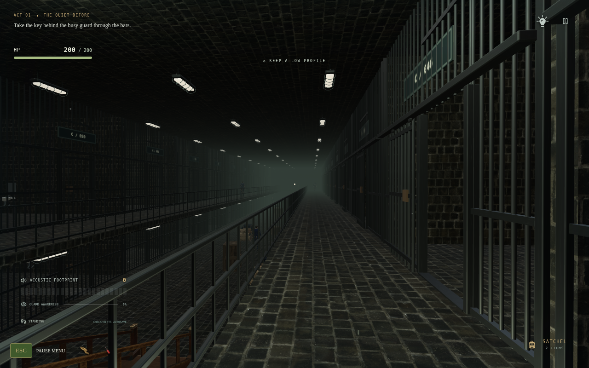
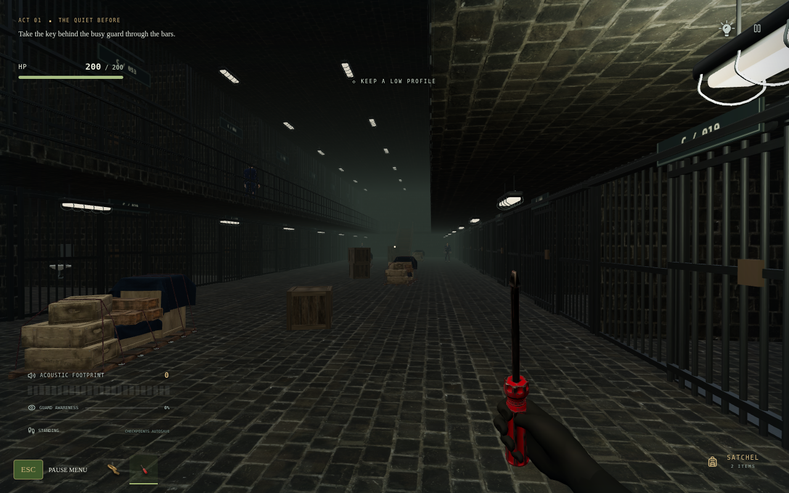
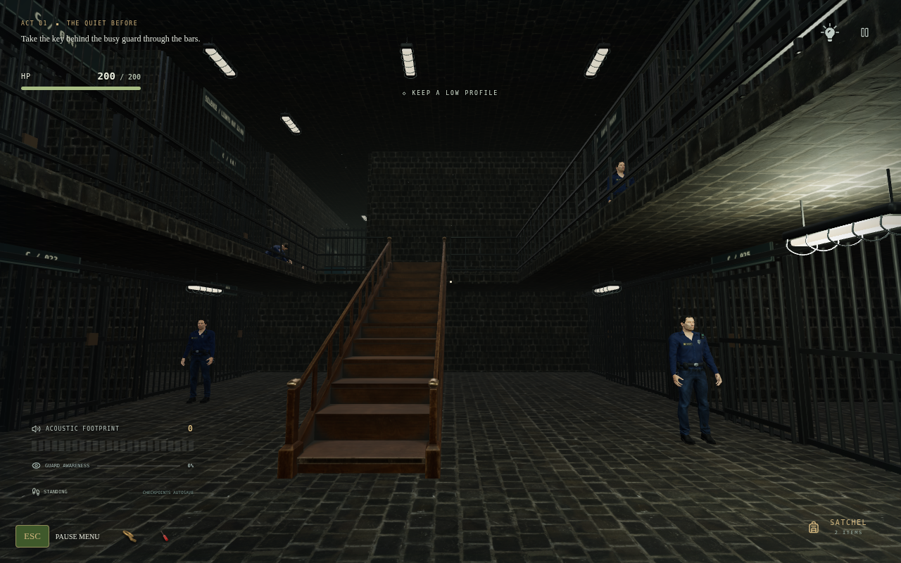
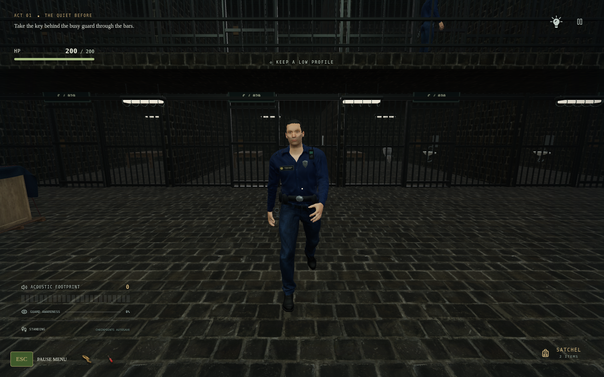
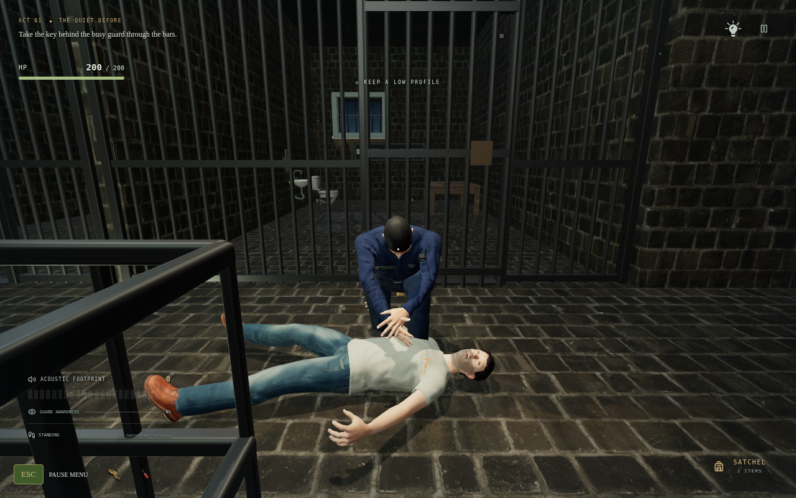
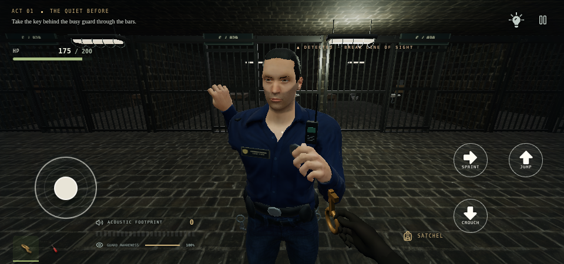

<div align="center">


# H I R O D O R A

### THE OBSIDIAN PENITENTIARY

**Every sound has a consequence.**

**v0.17.0 · Wooden Stairs / Cargo Cover / 200 HP**

**[↓ DOWNLOAD ANDROID APK](https://raw.githubusercontent.com/Rememberfrxst/Hirodora/main/downloads/Hirodora-0.17.0-android.apk)**

[↓ Offline web ZIP](https://raw.githubusercontent.com/Rememberfrxst/Hirodora/main/downloads/Hirodora-0.17.0-offline.zip) · [Single-file HTML download](https://raw.githubusercontent.com/Rememberfrxst/Hirodora/main/downloads/Hirodora-0.17.0.html) · [ZIP checksum](downloads/latest.json) · [APK checksums](downloads/android-latest.json) · [Android installation](docs/ANDROID.md)

</div>

## A playable prison atrium

**Cell 46's gate now stays open in the current opening chapter**, including previously closed saves. Complete the Cell 47 passage, choose **Explore Cell 46**, then walk through its open gate to inspect both floors. The gate's Close action is disabled so it stays available for testing. Guards remain active. [Exploration patch](docs/CELL46-EXPLORATION.md).

Block C has **48 cells: 12 left and 12 right on each of two playable floors**. The corridor is now **12 metres wide**, down from 14m: two unchanged 3-metre upper galleries surround a **6-metre central opening**. The supplied textured **wooden stair GLB replaces both concrete flights**, with navigation following the actual eleven treads. **Five strapped pallets and eight wooden crates** form staggered lower-floor cargo bays and crouch cover, leaving cell fronts and stair landings accessible. Muted green distance fog remains. Cell interiors retain their original widths and 9.5m depths; every cell has a **full-width barred front** with its own **1.4m sliding door**. Leaves park over their own fixed panel and pause if a player or officer blocks their sweep. Four officers serve upstairs and five patrol downstairs.

You now have **200 HP**. A confirmed guard at close range winds up and strikes for **25 damage** at the animation's contact moment, rather than instantly ending the game. Back away or break line of sight to make a punch miss. Solid walls, closed bars and different floor levels prevent hits; a short shared grace window prevents simultaneous officers deleting your health in one frame. Guards hold their spacing between swings. HP is saved at checkpoints, old saves default to 200, and New game restores 200. No passive healing is added. Walking cadence follows travelled distance, kneeling search/body-check poses transition from locomotion, and punches use clenched skeletal hands. These are authored animations, not a full physics fighting system.

The supplied **Redeemed Warrior** occupies Cell 46, preserving Boulder's interaction and challenge. Its USDZ is converted to a local 2.1 MB textured GLB. Equipment now uses a **black-gloved anatomical hand**, a neutral wrist and separate power, key-pinch and pistol poses. The screwdriver handle crosses the curled fingers instead of sitting along them. **Bottom-left pocket icons** show collected items using transparent renders of the actual game meshes; tap/click an icon to equip or unequip it. The selection is saved. Mobile pockets dock below the joystick when space allows, or above left-side controls for large/mirrored layouts. The satchel remains available for item descriptions and documents. Dart ammo/fire controls only appear for the dart pistol.

The top-right HUD has only **Hint** and **Pause**. The bulb and up-arrow references have vector renditions: jump points up, crouch down and sprint right. The touch interaction button is hidden when no action is available; nearby actions display Push, Unbolt, Move, Open or Penetrate with hold progress. Map, story, restart and New game remain in Pause. **To main menu** opens the reference-style **Yes / No** confirmation, defaulting to No with keyboard focus management.

**Police replacement remains pending:** a local 69-bone conversion of the supplied mesh has been prepared for inspection. Complete source/license details are required before publishing it; grip/deformation polishing remains open. This release ships the previously licensed officers. The Warrior is static source geometry; breathing presentation does not imply a new skeletal performance.

[Current implementation and verification](docs/CARGO-COMBAT-V17.md) · [Gloves / pocket HUD](docs/REFERENCE-V16.md) · [Character credits](docs/GUARD-ASSETS.md) · [New asset credits](src/assets/environment/CARGO-LICENSES.txt)

## Latest screenshots — exactly six

Six actual game renders, not generated artwork. [Camera positions and render statistics](docs/screenshots/cargo-v17/capture.json).

Identical-camera comparisons: [previous corridor](docs/screenshots/reference-v16/01-corridor.png) → [narrower corridor](docs/screenshots/cargo-v17/01-corridor.png); [concrete stairs before](docs/screenshots/reference-v16/03-lower-hall.png) → [supplied wooden stairs after](docs/screenshots/cargo-v17/03-wooden-stairs.png). Inventory and HP displays differ with the new features. Historical captures remain available.

<table>
<tr><td width="50%"></td><td width="50%"></td></tr>
<tr><td align="center"><sub>6-METRE OPENING · 48 CELLS</sub></td><td align="center"><sub>REAL GLB CARGO · CROUCH COVER</sub></td></tr>
<tr><td></td><td></td></tr>
<tr><td align="center"><sub>WOODEN STAIRS · REAL TREAD HEIGHTS</sub></td><td align="center"><sub>DISTANCE-DRIVEN WALK CYCLE</sub></td></tr>
<tr><td></td><td></td></tr>
<tr><td align="center"><sub>KNEEL · BODY INSPECTION</sub></td><td align="center"><sub>MOBILE · TIMED STRIKES · 200 HP</sub></td></tr>
</table>

## Play on mobile

Download the APK above, open it in Android Files and allow installation from that source when prompted. Requires **Android 8.0+**, an updated Android System WebView and WebGL 2. The app opens horizontally and includes all models, textures and audio offline, with **no Internet, storage, microphone or tracking permission**.

Version 0.17.0 uses the existing release certificate and versionCode **1700**. Older saves migrate to safe walkways and fitted stair treads, retaining inventory and puzzles. Install over an earlier release to retain app-local saves and settings; uninstalling clears them.

For the web edition, download through the direct ZIP link above, extract it and open `Hirodora-0.17.0.html` in a full WebGL 2 browser. The links bypass GitHub's large-file preview. File handling depends on your device. On iPhone/iPad, use the hosted PWA; a local HTML viewer may block scripts. Portrait play pauses behind a rotate notice.

## How to finish the current chapter

1. Start in Cell 47 after the intro. While the officer examines the prisoner outside, aim at the key behind him and press **E / Interact**.
2. Try it on your cell lock. The notice reveals that it belongs to **Cell 42**, not Cell 47.
3. Aim at the **table**. Hold **E / Push table** to move it quietly. **R / Push hard** is faster but attracts the officer.
4. Collect the screwdriver revealed beneath the table.
5. Hold the action on the toilet bolts, then hold **Move toilet**.
6. Aim at the exposed opening and select **Penetrate** to enter Cell 46. The chapter checkpoint is saved; **Explore Cell 46** lets you continue exploring or return through the passage.

Cells 45–42 are present but their story progression remains unfinished. Older v2 campaign saves remain supported.

## Controls and systems

| Action                 | Desktop             | Mobile               |
| ---------------------- | ------------------- | -------------------- |
| Move / look            | WASD / mouse        | Joystick / drag      |
| Interact / hold        | E                   | Interact             |
| Push harder            | R                   | Push hard            |
| Crouch / sprint / jump | C / Shift / Space   | Action buttons       |
| Pause                  | Escape / pause icon | Pause / Android Back |

Settings has Game, Audio, Graphics and Controls tabs. **Controls → Custom HUD** supports drag, resize, presets and saved layouts. Graphics has Low, Medium, High and Ultra presets, render scale and FOV. Pause → Retry checkpoint restarts a checkpoint; **New game** resets progress after confirmation.

Guards use wall-aware vision, suspicion, spatial hearing, last-known-position searches and sight-loss/reacquisition. Skeletal animation follows authoritative AI decisions. The intro, gun-grip fix and stable-frame rendering remain intact. Cell 47 is quiet at rest; **70 local recordings** provide material footsteps, object movement, doors, tools and spatial English guard speech.

## Development

The game uses **TypeScript, React, Three.js and Web Audio**, built with Vite. Android is a signed **Java WebView** wrapper, not a Unity/C# or native C++ port.

```sh
bun install --frozen-lockfile
npm run dev
npm run check
PLAYWRIGHT_CHROMIUM_EXECUTABLE=/usr/bin/chromium npm run test:e2e
npm run package:mobile
npm run package:android
```

Node 24+ is required. Android builds additionally require JDK 21, SDK 35/build-tools 35.0.0 and Gradle 8.13. See [Android build and signing](docs/ANDROID.md). Signing credentials stay outside this repository.

To regenerate the supplied-asset derivatives:

```sh
node scripts/prepare-uploaded-assets.mjs rock_wall_16_2k.zip basic_table.glb dirty_toilet.glb free_screwdriver.glb
node scripts/prepare-cargo-assets.mjs wooden_stairs_5_mb.glb wood_box.glb wood__boxes_strapped_on_palet.glb
```

The offline pipeline needs ffmpeg and preserves attribution. Original source uploads are not required at runtime. Textures are shared across rooms; superseded bunk/toilet meshes are excluded from the loaded fixture library. The build enforces a 100 MiB offline budget; exact download sizes and hashes are in [the manifests](downloads/android-latest.json).

## Quality and release status

Asset/logic tests, browser gameplay tests, production packaging and signed-APK validation are documented in [CARGO-COMBAT-V17.md](docs/CARGO-COMBAT-V17.md). The current checks cover real stair surfaces/cargo bounds, 200 HP combat, both floors, patrol movement, the opening and legacy campaign, HUD, checkpoints, intro, stealth and offline startup. See the [release verification report](docs/verification/cargo-v17/report.json) for exact run outcomes; physical-phone testing is separate.

Physical-phone frame rate, thermal behavior and device-specific WebView/GPU compatibility still need hardware testing. Software-rendered browser checks are not Android-device certification or a promise of glitch-free gameplay. Existing licensed guard models are preserved; the supplied police replacement still needs its source/license details and grip polish. The supplied Warrior is integrated.

## Sources and credits

| Asset                                                                                                            | Creator                 | License   |
| ---------------------------------------------------------------------------------------------------------------- | ----------------------- | --------- |
| [Rock Wall 16](https://polyhaven.com/a/rock_wall_16)                                                             | Amal Kumar / Poly Haven | CC0 1.0   |
| [Basic Table](https://sketchfab.com/3d-models/basic-table-a017d2120a504b6ebccf94d651321ca4)                      | Blender3D               | CC BY 4.0 |
| [Dirty Toilet](https://sketchfab.com/3d-models/dirty-toilet-389d5427a1f344c4aa4883ec5a6aaf05)                    | shedmon                 | CC BY 4.0 |
| [Free Screwdriver](https://sketchfab.com/3d-models/free-screwdriver-daa1a4a4013b479097633f75a33bb543)            | Filip                   | CC BY 4.0 |
| [Wooden Stairs](https://sketchfab.com/3d-models/wooden-stairs-5-mb-56271a83e8ff487b84289e39a159d3c5)             | Mehdi Shahsavan         | CC BY 4.0 |
| [Wood Box](https://sketchfab.com/3d-models/wood-box-ed74acd9b510481eb43a7753754d7ac8)                            | kakou3991               | CC BY 4.0 |
| [Strapped Pallet](https://sketchfab.com/3d-models/wood-boxes-strapped-on-palet-42652beb14e34e0a94d5f980ebb1869e) | Claudiu                 | CC BY 4.0 |
| [Wood furniture movement](https://freesound.org/people/ralph.whitehead/sounds/565727/)                           | ralph.whitehead         | CC0 1.0   |

Adaptations: real-world scaling/orientation, table PBR conversion, texture encoding, normalized stone normals, tread/railing fitting, pallet simplification, meshopt compression and project-authored mounting/puzzle integration. License links and modification notices ship inside the web build, offline HTML/ZIP and APK. [Previous uploaded-asset credits](src/assets/environment/UPLOADED-ASSET-LICENSES.txt) · [Wood asset credits](src/assets/environment/CARGO-LICENSES.txt).

Officers/prisoner derive from MakeHuman CC0 anatomy, licensed photo skin and authored clothing; walk/run use CMU motion capture under its terms. [Character sources and changes](docs/GUARD-ASSETS.md). Retained fixture geometry is project-authored; retained metal maps have their [original license](src/assets/environment/TPS-ASSET-LICENSE.txt). [Audio credits](docs/AUDIO.md) and [recording manifest](src/assets/audio/manifest.json). No Rockstar assets are included.

Previous milestones: [ceramic jail / foley](docs/CELL-V10.md) · [stealth / frame stability](docs/STEALTH-V9.md) · [intro / settings](docs/INTRO-V8.md) · [custom HUD](docs/HUD-V7.md) · [environment sources](docs/ENVIRONMENT-ASSETS.md).

<div align="center"><sub>HIRODORA · GULL ROCK PENITENTIARY · EVERY SOUND HAS A CONSEQUENCE.</sub></div>
