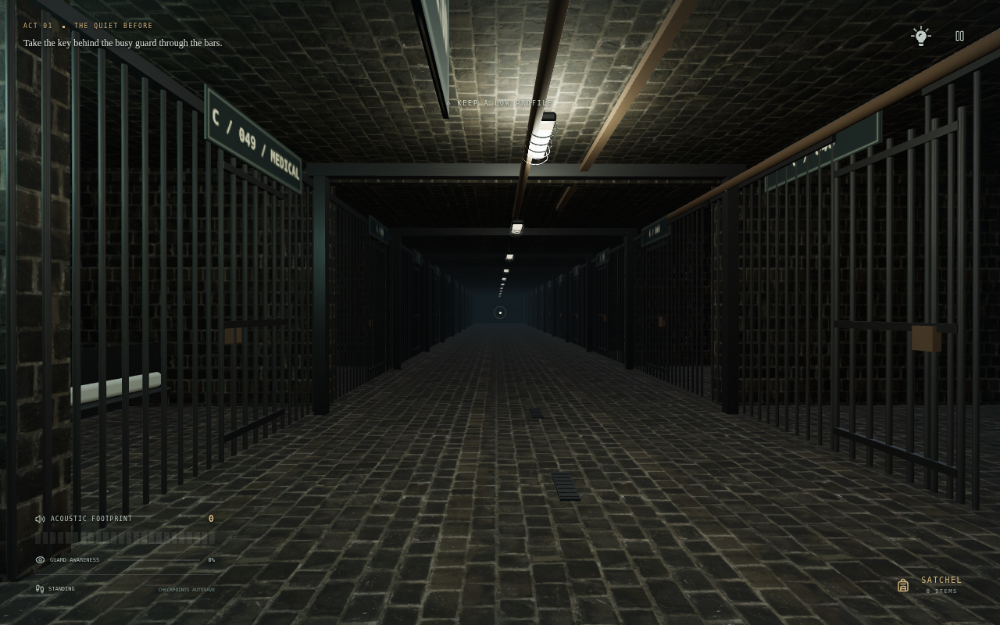
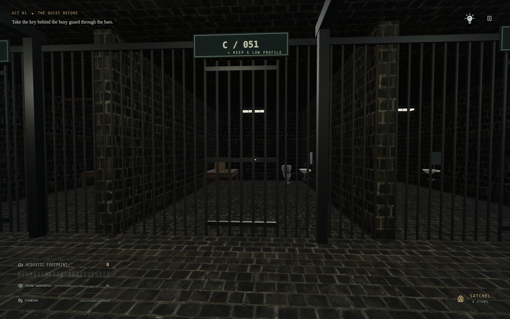
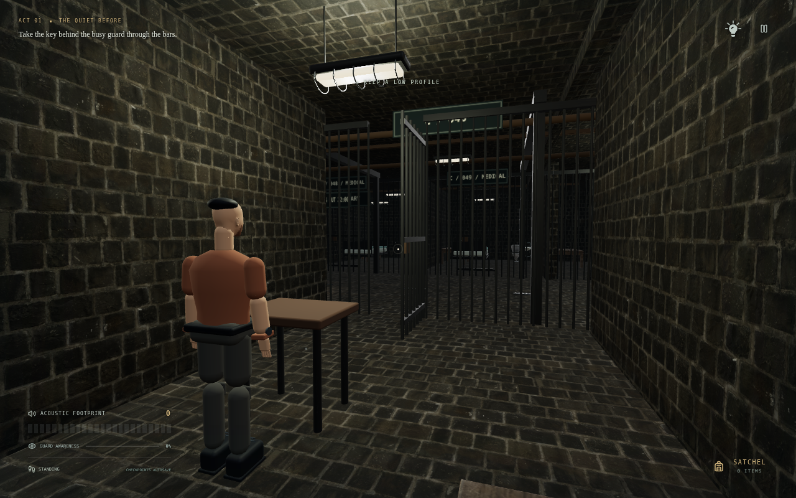
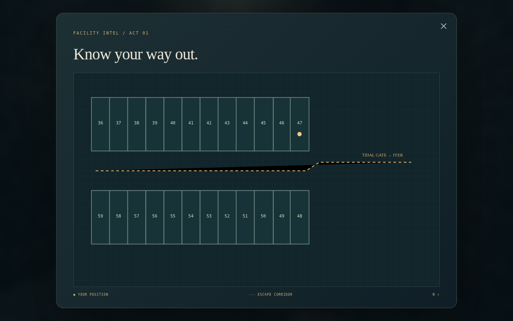
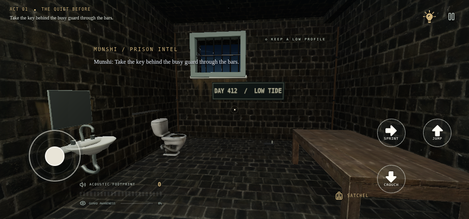
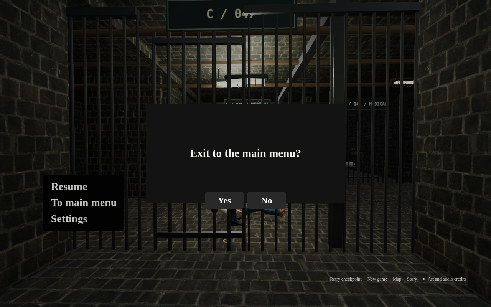

<div align="center">


# H I R O D O R A

### THE OBSIDIAN PENITENTIARY

**Every sound has a consequence.**

**v0.12.0 · 24 Cells / Reference HUD**

**[↓ DOWNLOAD ANDROID APK](https://github.com/Rememberfrxst/Hirodora/raw/refs/heads/main/downloads/Hirodora-0.12.0-android.apk)**

[Offline web ZIP](https://github.com/Rememberfrxst/Hirodora/raw/refs/heads/main/downloads/Hirodora-0.12.0-offline.zip) · [Single-file HTML](https://github.com/Rememberfrxst/Hirodora/raw/refs/heads/main/downloads/Hirodora-0.12.0.html) · [APK checksums](downloads/android-latest.json) · [Android installation](docs/ANDROID.md)

</div>

## 24 cells · wider corridor · cleaner HUD

Block C now has **12 north-side cells (36–47) and 12 south-side cells (48–59)** facing a **7-metre central corridor**. The original Cell 47 / Cell 46 opening coordinates and puzzle remain intact. All new cells use the existing licensed Rock Wall 16 PBR materials and supplied table/toilet assets. Cells 48/49 retain medical-room access for the legacy campaign.

Added exploration gates have working latches, collision-safe hinges and saved state. After reaching Cell 46, its gate can be opened to explore the block; Cells 42–45 remain story-locked. Repeated GLB fixtures use spatially chunked GPU instances; welded gate bars are batched by material. This reduces draw-call overhead without replacing assets with primitive proxies.

The top-right HUD has only **Hint** and **Pause**. The bulb and up-arrow references have vector renditions: jump points up, crouch down and sprint right. The touch interaction button is hidden when no action is available; nearby actions display Push, Unbolt, Move, Open or Penetrate with hold progress. Map, story, restart and New game remain in Pause. **To main menu** opens the reference-style **Yes / No** confirmation, defaulting to No with keyboard focus management.

**Character replacement is not complete:** `the_redeemed_warrior.glb` exceeds this environment's 32 MiB upload-transfer limit. The 16.8 MB police GLB has no rig, animation or source/license metadata. Existing characters are retained until a smaller warrior file/direct link and police redistribution permission/source are supplied. The original desktop-path PNG files are also unavailable; screenshots show vector renditions, not the original PNG bytes.

[Implementation, verification and remaining blockers](docs/CELL-BLOCK-V12.md) · [Asset credits](src/assets/environment/UPLOADED-ASSET-LICENSES.txt)

## Latest screenshots — exactly six

Actual game/UI renders. The floor-plan image uses the same 24-cell metadata as the level; the Cell 46 view stages the unlocked exploration gate. No new character model is claimed in these images. [Capture positions and render statistics](docs/screenshots/block-v12/capture.json).

<table>
<tr><td width="50%"></td><td width="50%"></td></tr>
<tr><td align="center"><sub>24-CELL BLOCK · 7-METRE CORRIDOR</sub></td><td align="center"><sub>OPPOSITE ROW · SHARED GLB FIXTURES</sub></td></tr>
<tr><td></td><td></td></tr>
<tr><td align="center"><sub>CELL 46 · WORKING GATE</sub></td><td align="center"><sub>FLOOR PLAN · 12 + 12</sub></td></tr>
<tr><td></td><td></td></tr>
<tr><td align="center"><sub>MOBILE · CONTEXTUAL HUD</sub></td><td align="center"><sub>MAIN MENU · SAFE CONFIRMATION</sub></td></tr>
</table>

## Play on mobile

Download the APK above, open it in Android Files and allow installation from that source when prompted. Requires **Android 8.0+**, an updated Android System WebView and WebGL 2. The app opens horizontally and includes all models, textures and audio offline, with **no Internet, storage, microphone or tracking permission**.

Version 0.12 uses the existing release certificate and increasing versionCode **1200**. Install over an earlier release to retain app-local saves and settings; uninstalling clears them. Browser and Android saves do not transfer automatically.

For the web edition, extract the ZIP and open `Hirodora-0.12.0.html` in a full WebGL 2 browser. File handling depends on your device. On iPhone/iPad, use the hosted PWA; a local HTML viewer may block scripts. Portrait play pauses behind a rotate notice.

## How to finish the current chapter

1. Start in Cell 47 after the intro. While the officer examines the prisoner outside, aim at the key behind him and press **E / Interact**.
2. Try it on your cell lock. The notice reveals that it belongs to **Cell 42**, not Cell 47.
3. Aim at the **table**. Hold **E / Push table** to move it quietly. **R / Push hard** is faster but attracts the officer.
4. Collect the screwdriver revealed beneath the table.
5. Hold the action on the toilet bolts, then hold **Move toilet**.
6. Aim at the exposed opening and select **Penetrate** to enter Cell 46. The chapter checkpoint is saved; **Explore Cell 46** lets you continue exploring or return through the passage.

Cells 45–42 are present but their story progression remains unfinished. This release does not add the previously discussed 24-cell layout. Older v2 campaign saves remain supported.

## Controls and systems

| Action                 | Desktop             | Mobile               |
| ---------------------- | ------------------- | -------------------- |
| Move / look            | WASD / mouse        | Joystick / drag      |
| Interact / hold        | E                   | Interact             |
| Push harder            | R                   | Push hard            |
| Crouch / sprint / jump | C / Shift / Space   | Action buttons       |
| Pause                  | Escape / pause icon | Pause / Android Back |

Settings has Game, Audio, Graphics and Controls tabs. **Controls → Custom HUD** supports drag, resize, presets and saved layouts. Graphics has Low, Medium, High and Ultra presets, render scale and FOV. Pause → Retry checkpoint restarts a checkpoint; **New game** resets progress after confirmation.

Guards use wall-aware vision, suspicion, spatial hearing, last-known-position searches and sight-loss/reacquisition. Skeletal animation follows authoritative AI decisions. The intro, gun-grip fix and stable-frame rendering remain intact. Cell 47 is quiet at rest; **70 local recordings** provide material footsteps, object movement, doors, tools and spatial English guard speech.

## Development

The game uses **TypeScript, React, Three.js and Web Audio**, built with Vite. Android is a signed **Java WebView** wrapper, not a Unity/C# or native C++ port.

```sh
bun install --frozen-lockfile
npm run dev
npm run check
PLAYWRIGHT_CHROMIUM_EXECUTABLE=/usr/bin/chromium npm run test:e2e
npm run package:mobile
npm run package:android
```

Node 24+ is required. Android builds additionally require JDK 21, SDK 35/build-tools 35.0.0 and Gradle 8.13. See [Android build and signing](docs/ANDROID.md). Signing credentials stay outside this repository.

To regenerate the supplied-asset derivatives:

```sh
node scripts/prepare-uploaded-assets.mjs rock_wall_16_2k.zip basic_table.glb dirty_toilet.glb free_screwdriver.glb
```

The offline pipeline needs ffmpeg and preserves attribution. Original source uploads are not required at runtime. Textures are shared across rooms; superseded bunk/toilet meshes are excluded from the loaded fixture library. The build enforces a 100 MiB offline budget; exact download sizes and hashes are in [the manifests](downloads/android-latest.json).

## Quality and release status

Asset/logic tests, browser gameplay tests, production packaging and signed-APK validation are documented in [CELL-BLOCK-V12.md](docs/CELL-BLOCK-V12.md). Browser tests cover both the opening and legacy campaign, audio, HUD, save/load, intro, collision, stealth and offline startup.

Physical-phone frame rate, thermal behavior and device-specific WebView/GPU compatibility still need hardware testing. Software-rendered browser checks are not Android-device certification or a promise of glitch-free gameplay. No AAA/GTA-level fidelity is claimed. Existing guard models are preserved. The uploaded police and warrior replacements are pending the file/license blockers above.

## Sources and credits

| Asset                                                                                                 | Creator                 | License   |
| ----------------------------------------------------------------------------------------------------- | ----------------------- | --------- |
| [Rock Wall 16](https://polyhaven.com/a/rock_wall_16)                                                  | Amal Kumar / Poly Haven | CC0 1.0   |
| [Basic Table](https://sketchfab.com/3d-models/basic-table-a017d2120a504b6ebccf94d651321ca4)           | Blender3D               | CC BY 4.0 |
| [Dirty Toilet](https://sketchfab.com/3d-models/dirty-toilet-389d5427a1f344c4aa4883ec5a6aaf05)         | shedmon                 | CC BY 4.0 |
| [Free Screwdriver](https://sketchfab.com/3d-models/free-screwdriver-daa1a4a4013b479097633f75a33bb543) | Filip                   | CC BY 4.0 |
| [Wood furniture movement](https://freesound.org/people/ralph.whitehead/sounds/565727/)                | ralph.whitehead         | CC0 1.0   |

Adaptations: real-world scaling/orientation, table PBR conversion, texture encoding, normalized stone normals, meshopt compression and project-authored mounting/puzzle integration. License links and modification notices ship inside the web build, offline HTML/ZIP and APK. [Full uploaded-asset credits](src/assets/environment/UPLOADED-ASSET-LICENSES.txt).

Officers/prisoner derive from MakeHuman CC0 anatomy, licensed photo skin and authored clothing; walk/run use CMU motion capture under its terms. [Character sources and changes](docs/GUARD-ASSETS.md). Retained fixture geometry is project-authored; retained metal maps have their [original license](src/assets/environment/TPS-ASSET-LICENSE.txt). [Audio credits](docs/AUDIO.md) and [recording manifest](src/assets/audio/manifest.json). No Rockstar assets are included.

Previous milestones: [ceramic jail / foley](docs/CELL-V10.md) · [stealth / frame stability](docs/STEALTH-V9.md) · [intro / settings](docs/INTRO-V8.md) · [custom HUD](docs/HUD-V7.md) · [environment sources](docs/ENVIRONMENT-ASSETS.md).

<div align="center"><sub>HIRODORA · GULL ROCK PENITENTIARY · EVERY SOUND HAS A CONSEQUENCE.</sub></div>
