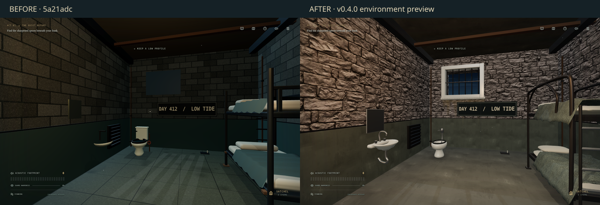

# Cell 47 environment assets — v0.4.0 feature build

This branch replaces the visible Cell 47 furniture with a shared, UV-mapped GLB library, and replaces the canvas wall/floor noise textures with local PBR maps. Cell 46 reuses the bunk; corridor and utility-room surfaces and luminaires use the same material/asset library. The prison layout, save key, interactions and AI are retained.

## Sources and redistribution

| Asset | Published source | License | Adaptation |
| --- | --- | --- | --- |
| Masonry albedo, normal, AO | [Godot material testers](https://github.com/godotengine/godot-demo-projects/tree/b761b4cd5718a7118f2c95eb55f181d0a5f004f1/3d/material_testers/test_materials), `texture_bricks.jpg`, `texture_bricks_normal.jpg`, `texture_bricks_ao.jpg` | MIT, Godot Engine contributors; [included notice](../src/assets/environment/GODOT-MIT-LICENSE.txt) | Desaturated albedo; resized to 512; authored conservative roughness derived from AO, packed AO/roughness/zero-metalness. Roughness is an adaptation, not a measured scan. |
| Fabric | Same pinned Godot source, `wool_albedo.png`, `wool_normal.png` | Same MIT notice | Grayscale albedo at 256, normal at 512, tinted olive in game. |
| Painted metal | [Godot TPS demo](https://github.com/godotengine/tps-demo/tree/a82f15448e9b015440d3bbdf5e10801b260c4e9f/level/textures/structure), `tile_painted_gun_metal_{albedo,normal,orm}.png` | CC BY 3.0; © 2018 Juan Linietsky and Fernando Miguel Calabró; [included source notice](../src/assets/environment/TPS-ASSET-LICENSE.txt); [license](https://creativecommons.org/licenses/by/3.0/) | 512px WebP, original packed ORM channels, recolored painted steel. The source notes that some Substance Painter materials derive from GameTextures.com. |
| Matte floor, ceiling and wall-paint finish | Same pinned TPS source, `tile_steel_{albedo,normal,orm}.png` | Same CC BY 3.0 attribution | Adapted worn-surface texture: nonmetallic response, higher roughness, restrained normals, mineral/paint tint. **This is not a downloaded concrete scan.** Filenames `concrete-*` identify the intended finish, not the original source material. |
| Bunk, toilet, sink, window, luminaire | Original Hirodora Blender authoring in [author-cell-assets.py](../scripts/author-cell-assets.py); [editable Blender source](../src/assets/environment/cell-props.blend) | Project-authored assets; no third-party model was incorporated | Curved welded frames; rounded cushion meshes; solidified folded cloth; revolved outer/inner sanitary shells; swept plumbing; UVs; bevelled sheet-metal parts; Meshopt GLB export. |
| Sill water-runoff decal and exterior matte | Original [water-stain.svg](../src/assets/environment/water-stain.svg), [exterior.svg](../src/assets/environment/exterior.svg) | Project-authored artwork | Rasterized offline; localized under sills. Exterior is a distant painted backdrop behind actual apertures, not a simulated outside level. |

The GLB is about 362 KiB and includes five named model roots. Clones reuse meshes and materials. Albedo maps use sRGB; normals and packed ORM use linear data. AO samples the same UV set as the material. UVs are explicitly retained through compression because materials are assigned at load time. Source `.blend` and authoring files do not enter the playable distribution.

Licenses are included in the standalone HTML/README and hosted `ENVIRONMENT-LICENSES.txt`. See [manifest](../src/assets/environment/manifest.json) for output checksums and source revisions. Normal gameplay makes no third-party asset requests.

## Network checks on 26 October 2026

Poly Haven metadata at `https://api.polyhaven.com/files/concrete_floor` returned HTTP 200. The actual file endpoint `https://dl.polyhaven.org/file/ph-assets/Textures/jpg/1k/concrete_floor/concrete_floor_diff_1k.jpg` returned HTTP 403, including an approved retry outside the sandbox. ambientCG's `https://ambientcg.com/get?file=Concrete034_1K-JPG.zip` redirected to `acg-download.struffelproductions.com/file/ambientCG-Web/download/Concrete034_jUQtDlJO/Concrete034_1K-JPG.zip`; that host was denied with HTTP 403. The current environment configuration lists the library sites, but neither download hostname. A restart is not established as necessary; the remaining restriction is on those two destinations.

Kenney's Furniture Kit ZIP downloaded successfully from `kenney.nl`, but its stylized models were not incorporated. No assets from the blocked hosts, GTA or unlicensed mirrors were used. Godot's published GitHub asset repositories were accessible.

## Lighting and integration

The rear wall now has real visual apertures and thick reveals, while its original gameplay/vision collider is retained. The window bars occlude a cool exterior spotlight; warm practical lights and a low-intensity PMREM reflection environment give metal/ceramic material depth. High/Ultra render actual window/key shadows; Low/Medium retain soft footprint contacts without shadow maps. No bloom, motion blur or depth-of-field pass was added: the browser image remains sharp, and mobile avoids extra fullscreen buffers.

Static architecture is batched. The bunk, bowl and sink are positioned against the unchanged gameplay bounds; exact colliders, door bounds, item coordinates and radii are recorded in the captures and compared in tests. The bowl has an inner shell and lowered water surface; cloth has thickness and clearance above the mattress. Guard skin/fabric materials are explicitly nonmetallic; skin/clothing normal intensity is reduced. In-place guard turns no longer replace the walking stride while AI translation is active.

## Render evidence

Baseline was run from a separate checkout of **5a21adc**, using the same script, 1280×800 viewport, explicit cameras, High preset and pixel ratio 1. The camera/pose is staged, so these are visual inspection frames, not claims of unassisted gameplay. Real patrol and end-to-end progression are tested separately.



| View | Baseline | Current |
| --- | --- | --- |
| Cell 47 | [Before](screenshots/environment/before/cell-47.png) | [After](screenshots/environment/after/cell-47.png) |
| Bunk | [Before](screenshots/environment/before/bunk.png) | [After](screenshots/environment/after/bunk.png) |
| Toilet / sink | [Before](screenshots/environment/before/fixtures.png) | [After](screenshots/environment/after/fixtures.png) |
| Window / ceiling | [Before](screenshots/environment/before/window-ceiling.png) | [After](screenshots/environment/after/window-ceiling.png) |
| Corridor | [Before](screenshots/environment/before/corridor.png) | [After](screenshots/environment/after/corridor.png) |
| Guard front | [Before](screenshots/environment/before/guard-front.png) | [After](screenshots/environment/after/guard-front.png) |
| Guard side | [Before](screenshots/environment/before/guard-side.png) | [After](screenshots/environment/after/guard-side.png) |

Intermediate `materials-models/` and `lighting/` captures record phase reviews, including the cloth-overlap and floor-response issues subsequently corrected. Final `after/` frames include the UV export fix. `capture.json` records exact camera targets, errors, render counters and gameplay geometry. These are software-rendered Chromium captures; they do not prove real-phone framerate or Safari quality.

## Rebuild and verify

Normal builds use committed assets and need no Blender or network access. To rebuild the authoring library, use Blender 4.3, clone the two pinned repositories above to `/tmp/hirodora-godot-assets` and `/tmp/hirodora-tps-assets` (or set `HIRODORA_GODOT_SOURCE` / `HIRODORA_TPS_SOURCE`), then run:

```sh
blender -b --python scripts/author-cell-assets.py
node scripts/prepare-environment.mjs
npm run check
node scripts/package-mobile.mjs
PLAYWRIGHT_CHROMIUM_EXECUTABLE=/usr/bin/chromium npm run test:e2e
# With the game running on port 3002:
PLAYWRIGHT_CHROMIUM_EXECUTABLE=/usr/bin/chromium node scripts/capture-environment.mjs after
```

## Remaining work

Validation for this revision: lint, 25 unit/asset checks, production/offline build and all 10 Playwright scenarios passed. The browser checks include the live world's collider/interaction comparison against 5a21adc, independent officer rigs, patrol/LOD/darts, asset-download failure/retry, all four puzzles and Brotherhood progression, mobile rotation and both hosted/downloaded offline play. The hosted offline payload is approximately 7.95 MiB, below the existing 8 MiB cap; the downloadable ZIP is approximately 5.39 MiB.

Dedicated concrete/floor scans are still unavailable from the two blocked download hosts. Current masonry is rough historic stone/brick, not a modern cinder-block scan. The new props are authored project assets, not third-party production prop scans; there is still room for further hand art-direction, finer mattress seams and wear painting. New bespoke doors, medical/laundry furniture and exterior scenery have not been authored. Existing officer meshes/rigs are retained, with material and presentation fixes rather than a new sculpt. Physical Android/iOS QA and prolonged GPU/performance testing remain open.
